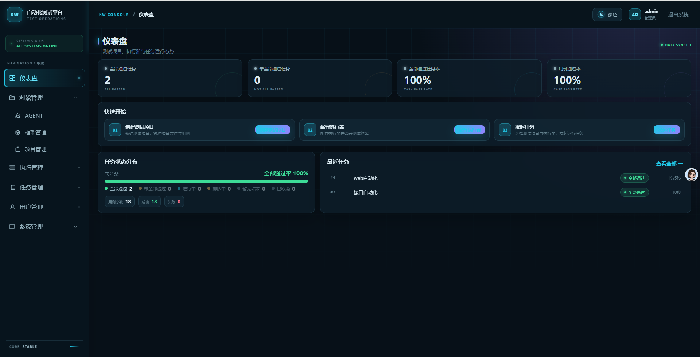
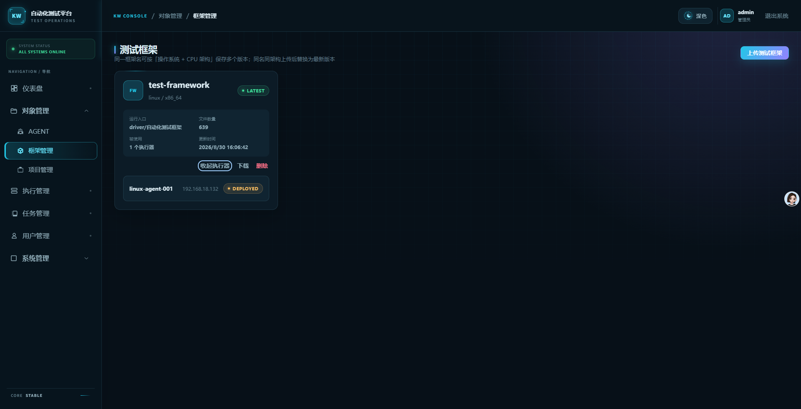
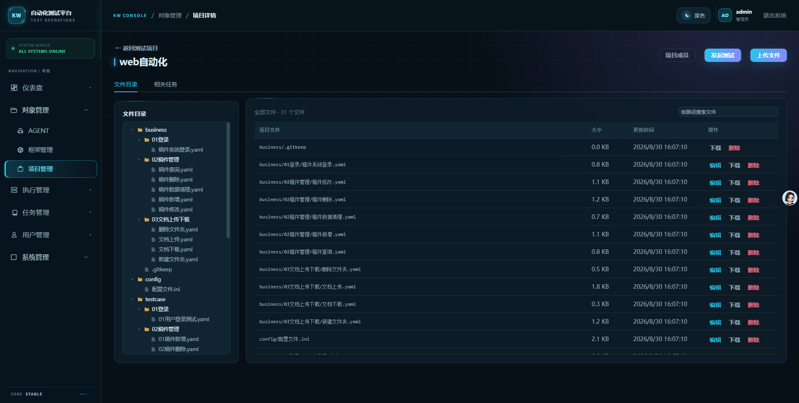
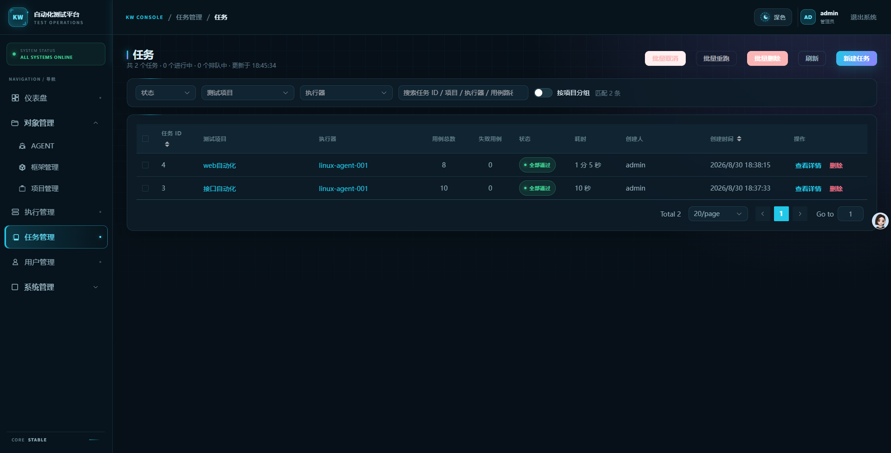
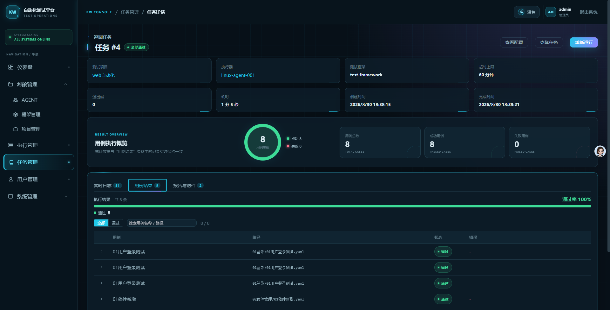

# 自动化测试平台

当前实现以 [`docs/platform-design.md`](docs/platform-design.md) 为准，用于集中管理用户、MinIO 对象、远端执行器和运行任务。

## 平台演示

平台围绕“项目维护 → 任务执行 → 结果查看”组织工作流。下面展示仪表盘、框架管理、项目文件和任务执行的演示界面。

### 仪表盘：查看测试运行概况

集中查看全部通过任务数、任务通过率、用例通过率、任务状态分布和最近任务，通过“快速开始”进入项目配置与任务执行。



### 框架管理：管理框架包与部署状态

按操作系统和 CPU 架构维护测试框架包，查看框架信息、使用该框架的执行器及部署状态。



### 项目文件：在线维护测试工程

通过目录树管理 `business / config / testcase`，保持测试工程的目录结构，在线查看和维护业务流程、项目配置与测试用例。



### 任务列表：跟踪执行状态

按状态、测试项目和执行器筛选任务，集中查看用例总数、失败数、执行耗时及创建人，并进入任务详情。



### 任务详情：查看日志、结果与报告

在同一页面查看执行概况、实时日志、结构化用例结果以及报告和附件，结合用例状态定位失败环节。



## 已实现

- 用户登录、三种系统角色和项目成员权限
- 测试项目和最新测试框架的统一对象管理
- 保持原目录结构的 MinIO 项目文件维护和任务快照
- Agent/runtime 镜像由管理员在远端人工部署，Agent 主动连接平台
- 平台生成一次性 Agent 注册命令，并向在线 Agent 部署最新框架
- `python cli.py` 与 Linux 打包可执行程序两种框架运行方式
- 创建任务时编辑完整 `配置文件.ini`
- PostgreSQL 持久化命令租约，Agent 按空闲槽主动领取并负责并发、取消和超时
- Redis Stream + WebSocket 实时日志
- 报告和日志归档下载
- FastAPI 内置轻量维护循环，自动恢复租约和失联状态

## 项目结构

平台采用模块化单体结构，后端和前端按同一业务名称组织：

```text
backend/app/
├── main.py                 # FastAPI 入口
├── router.py               # 业务模块路由聚合
├── platform/               # DB、Redis、MinIO、认证算法等技术能力
├── shared/                 # 文件、资源模型、项目权限等跨模块能力
└── modules/                # auth/users/objects/executors/tasks/agent_gateway

frontend/src/
├── app/                    # 应用装配、布局、导航、总路由
├── platform/               # HTTP 客户端和本地登录会话
├── shared/                 # 公共组件、主题和术语
└── modules/                # 与后端业务模块对应的页面、API 和路由
```

新增菜单或接口前请阅读 [`docs/module-development-guide.md`](docs/module-development-guide.md)。完整迁移设计见 [`docs/modular-refactor-plan.md`](docs/modular-refactor-plan.md)。旧横向业务目录及兼容导出已经移除。

## 一键启动

```bash
cp .env.example .env
# 修改 .env 中的数据库、MinIO、JWT 和管理员密码
docker compose up -d --build
```

访问地址：

- 平台：<http://localhost>
- API 文档：<http://localhost:8000/docs>
- MinIO：<http://localhost:9001>

未设置 `.env` 时的首次登录账号为 `admin / admin123`，仅适合本地验证。

## 第一次使用

1. 在“对象管理”上传测试框架并创建测试项目。
2. 在测试项目中上传原 `testsuits/<项目>` 下的 `testcase`、`business`、`config` 文件。
3. 管理员在目标 Linux 主机人工安装 Docker，并导入 `kw-agent`、`kw-executor-runtime` 镜像；目标主机可以与平台同机。
4. 在“环境管理 / 执行器环境管理”创建环境，复制一次性 Agent 命令到远端执行；Agent 在线后点击“部署框架”。
5. 新建任务，选择测试项目和已就绪环境，编辑本次 INI 后运行。
6. 在任务详情查看实时日志、结果和报告。

远程机器无需访问 MinIO、Redis 或数据库，也不需要向平台开放 SSH。Agent 只需能主动访问平台 HTTP/WebSocket；镜像安装和升级由管理员人工完成。

## 前端主题复用

- `frontend/src/shared/theme/index.js` 统一管理主题状态、系统主题跟随和本地持久化。
- `frontend/src/shared/theme/theme.css` 提供颜色、背景、边框、阴影等语义变量，并统一适配 Element Plus。
- `frontend/src/shared/theme/ThemeToggle.vue` 是可直接复用的主题切换组件。
- 新页面使用全局 `.page`、`.page-head`、`.card`、`.toolbar`、`.status-*` 等基础样式，并通过 `var(--text-primary)`、`var(--surface)` 等语义变量扩展，无需编写深浅主题判断。

## 开发检查

```bash
python -m pytest -q
python -m compileall -q backend agent
cd frontend && npm install && npm run build
```

完整设计、接口、数据库和部署说明统一放在 [`docs`](docs) 目录；远端执行器安装已合并到部署文档，避免多处说明不一致。

## License

本项目采用 [Apache License 2.0](LICENSE)，使用[官方标准许可文本](https://www.apache.org/licenses/LICENSE-2.0.txt)，不添加定制条款。第三方依赖遵循各自的许可协议。
