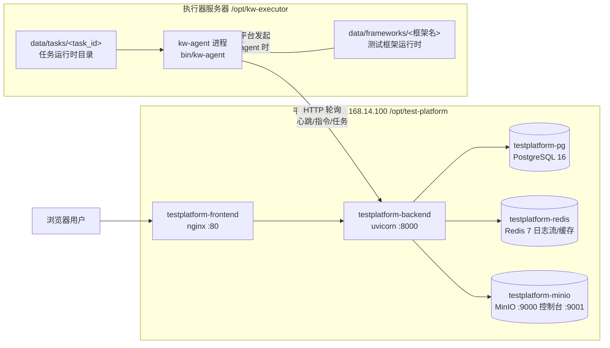

# Test Platform 部署指南（平台 / Agent / 测试框架）

> 适用对象：测试平台维护者。
> 覆盖三个组件的完整部署：**① 平台（backend + frontend + PostgreSQL + MinIO + Redis）**、**② Agent 执行器**、**③ 测试框架**。
> 本文档所有命令均以当前生产环境为准：服务器 CentOS 7（192.168.14.100，root 登录），平台目录 `/opt/test-platform`，Agent 目录 `/opt/kw-executor`。

---

## 目录

- [0. 总体部署流程与组件架构](#0-总体部署流程与组件架构)
- [第一部分：平台部署](#第一部分平台部署)
- [第二部分：Agent 部署](#第二部分agent-部署)
- [第三部分：测试框架部署](#第三部分测试框架部署)
- [第四部分：端到端验证](#第四部分端到端验证)
- [附录：常用运维命令速查](#附录常用运维命令速查)
- [附录：py312-centos7 构建容器构建指南（从零搭建）](#py312-centos7-构建容器构建指南从零搭建)

---

## 0. 总体部署流程与组件架构

### 0.1 总体部署流程图

三个组件存在严格的部署顺序依赖：**平台必须先就绪**（Agent 需要连上平台心跳、框架包存在 MinIO 里）→ **Agent 必须先上线**（框架部署指令是 Agent 轮询拉取的，Agent 不在线无法下发）→ **框架部署完成后才能跑任务**。

```mermaid
flowchart TD
    A0[准备服务器<br/>CentOS7 + Docker + docker-compose] --> A1
    subgraph P1[第一阶段：平台部署]
        A1[上传代码到 /opt/test-platform] --> A2[生成 .env<br/>修改密码与 AGENT_PUBLIC_URL]
        A2 --> A3[执行 scripts/deploy-docker.sh<br/>构建 backend/frontend 镜像]
        A3 --> A4[compose 启动五容器<br/>pg / redis / minio / backend / frontend]
        A4 --> A5[自动初始化<br/>建表 + MinIO 桶 + 管理员 admin]
        A5 --> A6[平台验证<br/>curl /health + 登录 + 页面访问]
    end
    A6 --> B0
    subgraph P2[第二阶段：Agent 部署]
        B0[准备 py312-centos7 构建容器<br/>源码编译 Python 3.12 兼容 CentOS7] --> B1[build.py 打包<br/>PyInstaller 产出 dist/agent.tar.gz]
        B1 --> B2[登录平台获取 Token<br/>POST /api/v1/auth/login]
        B2 --> B3[上传 Agent 包<br/>POST /api/v1/objects/agents]
        B3 --> B4[创建执行器并配置 SSH 凭据<br/>POST/PUT /api/v1/environments]
        B4 --> B5[测试 SSH 连接<br/>探测 os / arch]
        B5 --> B6[触发部署<br/>POST /environments/id/deploy-agent<br/>上传 + 解压 + 生成配置 + 启动]
        B6 --> B7[等心跳上线<br/>agent_status = online]
    end
    B7 --> C0
    subgraph P3[第三阶段：测试框架部署]
        C0[准备框架归档<br/>确认 runner_path 与 archive_root] --> C1[上传框架<br/>POST /api/v1/objects/frameworks]
        C1 --> C2[执行器绑定框架并下发部署<br/>POST /environments/id/deploy<br/>framework_status = pending]
        C2 --> C3[Agent 轮询 actions 拿到指令<br/>下载 + SHA256 校验 + 解压]
        C3 --> C4[archive_root 提升<br/>归档平铺为 frameworks/框架名]
        C4 --> C5[内嵌二进制补执行权限<br/>ELF / Mach-O chmod +x]
        C5 --> C6[校验 runner 入口<br/>原子切换旧目录到 .old]
        C6 --> C7[上报 deployed<br/>framework_status = deployed]
    end
    C7 --> D0
    subgraph P4[第四阶段：端到端验证]
        D0[创建测试任务] --> D1[Agent 领取任务<br/>克隆框架 + 注入项目]
        D1 --> D2[执行用例 + 流式回传日志]
        D2 --> D3[收集结果与报告<br/>任务状态 success / failed]
    end
```



### 0.2 组件架构图



关键通信关系说明：

- **用户 → 前端(80) → 后端(8000)**：前端 nginx 把 `/api/` 反代到 backend 容器，页面静态资源由 nginx 直接提供。
- **平台 → 执行器（SSH）**：只在「部署 Agent」时使用，平台通过 paramiko SSH/SFTP 上传包并启动进程，日常运行不依赖 SSH。
- **执行器 Agent → 平台（HTTP 轮询）**：Agent 主循环约每 3 秒一轮（`task_poll_interval`），每轮先发心跳、再拉取部署指令和任务（`config.yaml` 中的 `heartbeat_interval: 10` 为保留配置项，当前实现心跳随主循环节拍发送），**全程只有 Agent 主动访问平台**，因此执行器必须能访问 `AGENT_PUBLIC_URL`（不能是 localhost）。
- **数据流**：框架归档、Agent 包、项目文件、任务产物全部存 MinIO；任务日志写入 Redis Stream 供前端实时查看。

---

## 第一部分：平台部署

### 1.1 前置条件

#### 1.1.1 服务器要求

| 项目 | 要求 |
| --- | --- |
| 操作系统 | CentOS 7（内核 3.10.x） |
| 网络 | 执行器服务器可访问本机 8000 端口；办公网可访问 80/8000/9001 |
| 端口占用 | 80（前端）、8000（后端）、9000/9001（MinIO API/控制台）空闲 |
| 磁盘 | ≥ 20GB（镜像 + PG/MinIO 数据卷） |

#### 1.1.2 软件版本

- **Docker**：≥ 20.10（CentOS7 上通常为 docker-ce 20.10.x）。
- **docker-compose**：**独立二进制 v5.4.0（standalone）**。⚠️ 本服务器上 `docker compose`（带空格的子命令）**不可用**，所有运维命令必须写成 `docker-compose`。如果执行 `docker compose version` 报错属正常现象，不代表环境有问题。
- 本地开发机需要 **Python 3.x + paramiko**（执行增量部署脚本），**不需要安装 Docker**——镜像构建在远端服务器上完成。

#### 1.1.3 安装 Docker 与 docker-compose（新机器时）

如果目标机器尚未安装 Docker：

```bash
# 1. 安装 docker-ce（CentOS7）
yum install -y yum-utils
yum-config-manager --add-repo https://mirrors.aliyun.com/docker-ce/linux/centos/docker-ce.repo
yum install -y docker-ce docker-ce-cli containerd.io
systemctl enable --now docker

# 2. 安装独立二进制 docker-compose（官方 releases 模板，VERSION 自选 ≥v2 稳定版）
VERSION=v5.4.0   # 版本以实际部署环境为准（本文环境实测 v5.4.0）
curl -L "https://github.com/docker/compose/releases/download/v${VERSION}/docker-compose-linux-x86_64" \
  -o /usr/local/bin/docker-compose
chmod +x /usr/local/bin/docker-compose

# 3. 验证
docker version
docker-compose version   # 注意：用 docker-compose（带横杠），不要用 docker compose
```

> **版本选择说明**：本项目脚本仅依赖 compose 基础参数（`-f` / `--project-directory` / `up -d` 等），任意 v2+ 独立二进制均可运行，安装版本以实际部署环境为准（本文环境实测 v5.4.0）。若 GitHub 直连受限，可自行替换为可用的镜像站地址，校验 `docker-compose version` 能正常输出即可。

> **为什么强调 docker-compose 写法**：远端只部署了独立二进制 compose，没有安装 Docker Compose v2 的 `docker compose` 插件。项目里的部署脚本会自动探测两种写法并选择可用的一种，但手工执行命令时必须自己注意。

### 1.2 首次部署

首次部署使用 `scripts/deploy-docker.sh`，它完成：检查 `.env` → 构建 backend/frontend 镜像 → `compose up` 启动五个容器 → 健康探测。

#### 步骤 1：上传项目代码到服务器

把整个仓库上传到 `/opt/test-platform`（scp / rsync / git clone 均可）：

```bash
# 在本地开发机执行（示例用 scp，目录较大时可先打 tar 包）
scp -r test-platform root@192.168.14.100:/opt/test-platform
```

上传后确认关键文件在位：

```bash
ssh root@192.168.14.100
cd /opt/test-platform
ls docker-compose.yml docker-compose.centos7.yml .env.example scripts/deploy-docker.sh backend/Dockerfile frontend/Dockerfile
```

> **注意**：必须包含 `docker-compose.centos7.yml`。CentOS7 + Docker 20.10 的默认 seccomp 配置会拒绝新版 glibc 使用的 `clone3` 系统调用，导致 backend 容器内 Python 报 `can't start new thread` 而启动失败。这个 overlay 文件为 backend 加了 `security_opt: seccomp=unconfined` 来规避。脚本检测到内核 `3.10.*` 时会自动叠加该文件。

#### 步骤 2：生成并修改 `.env`

```bash
cd /opt/test-platform
cp .env.example .env
vi .env
```

必须核对/修改的字段：

| 字段 | 说明 | 本环境取值 |
| --- | --- | --- |
| `POSTGRES_PASSWORD` | 数据库密码（与 PG 容器初始化一致） | 自定义强密码 |
| `MINIO_ROOT_PASSWORD` | MinIO 密码 | 自定义强密码 |
| `JWT_SECRET` | 登录令牌签名密钥 | 长随机串 |
| `SUPERADMIN_USERNAME` / `SUPERADMIN_PASSWORD` | 初始管理员（首次启动自动创建） | admin / 生产上务必改掉 admin123 |
| `AGENT_PUBLIC_URL` | **Agent 访问平台用的地址，绝不能写 localhost** | `http://192.168.14.100:8000` |

> **AGENT_PUBLIC_URL 为什么重要**：平台部署 Agent 时会把这个地址写进执行器上的 `config/config.yaml`（`platform.url`）。如果写成 `http://127.0.0.1:8000`，Agent 心跳会打到执行器自己的 127.0.0.1，永远上不了线。必须保证从执行器服务器可达。

#### 步骤 3：执行首次部署脚本

```bash
cd /opt/test-platform
bash scripts/deploy-docker.sh
```

脚本行为逐条说明：

1. **检查 `.env`**：不存在时从 `.env.example` 复制一份并提示你修改后重跑（防止用默认密码裸奔上线）。
2. **探测 compose 命令**：优先 `docker compose`，退回 `docker-compose`。本环境会选中 `docker-compose`。
3. **探测 CentOS7**：`uname -r` 为 `3.10.*` 且存在 overlay 文件时，自动叠加 `-f docker-compose.yml -f docker-compose.centos7.yml`。
4. **构建后端镜像**：`docker build -f backend/Dockerfile -t testplatform-backend:v1 .`。
5. **构建前端镜像**：`docker build -f frontend/Dockerfile -t testplatform-frontend:v1 .`（node:22-alpine 阶段 `npm ci && npm run build`，nginx:1.27-alpine 托管产物）。
6. **启动容器**：`docker-compose up -d --no-build --remove-orphans`，五个容器全部拉起（PG/Redis/MinIO 带 healthcheck，backend 等三者健康后才启动）。
7. **健康探测**：轮询 `curl http://127.0.0.1:8000/health` 最多 120 秒，成功即打印 API 就绪并退出。

> ⚠️ **CentOS7 上的 pip 源坑（重要）**：脚本在检测到 3.10 内核时会把 `PIP_INDEX_URL` 默认置为 aliyun 镜像并传给 `docker build --build-arg`。**实测 aliyun 源对 pydantic 返回 `from versions: none`，会导致后端镜像构建失败**。backend/Dockerfile 本身的默认值是「清华主源 + aliyun 备源 + trusted-host」，这是验证可用的组合。因此在 CentOS7 上执行脚本前，请显式把 pip 源固定为清华源：
>
> ```bash
> cd /opt/test-platform
> PIP_INDEX_URL=https://pypi.tuna.tsinghua.edu.cn/simple bash scripts/deploy-docker.sh
> ```
>
> 同理，手工执行 `docker build` 时**不要传 `--build-arg PIP_INDEX_URL` 覆盖**，让 Dockerfile 用默认的清华源即可。

#### 步骤 4：确认初始化结果

backend 容器首次启动时，FastAPI lifespan 会自动执行 `initialize_database()`：

- `Base.metadata.create_all` 建全部表，并执行若干兼容性迁移；
- 创建 MinIO 桶：`test-projects` / `test-frameworks` / `test-task-artifacts` / `test-agents`；
- 若 `SUPERADMIN_USERNAME` 不存在则创建管理员账号（默认 `admin / admin123`，取决于 `.env`）。

**不需要手工建库或导 SQL**。查看日志确认初始化无异常：

```bash
docker-compose -f docker-compose.yml -f docker-compose.centos7.yml logs --tail=100 backend
```

#### 步骤 5：平台验证

```bash
# 1. 容器状态：五个容器均应 Up（healthy）
docker-compose ps

# 2. 后端健康检查（在服务器本机执行）
curl -fsS http://127.0.0.1:8000/health
# 期望输出：{"status":"ok"}

# 3. 登录验证（在服务器本机执行）
curl -s -X POST http://127.0.0.1:8000/api/v1/auth/login \
  -H 'Content-Type: application/json' \
  -d '{"username":"admin","password":"admin123"}'
# 期望返回 {"access_token":"eyJ...","token_type":"bearer",...}

# 4. 前端验证
curl -fsS -o /dev/null -w '%{http_code}\n' http://127.0.0.1/
# 期望输出：200

# 5. MinIO 控制台（浏览器访问）
# http://192.168.14.100:9001  用 .env 中 MINIO_ROOT_USER/PASSWORD 登录
```

> **验证位置注意**：由于网络隔离，**从本地开发机直接 curl `192.168.14.100` 可能被网关阻断（502）**。所有 curl 验证请先 `ssh root@192.168.14.100` 登录服务器后在本机执行 `curl 127.0.0.1:...`；浏览器访问页面则不受此限制。

### 1.3 增量部署

日常代码更新**不需要**重跑 deploy-docker.sh，使用两个 paramiko 脚本（在本地开发机执行，本机无需 Docker，构建发生在远端）。

#### 1.3.1 前端增量部署（改了 frontend/ 下任何文件）

```bash
# 本地开发机，项目根目录下执行
DEPLOY_PASS='<SSH_PASSWORD>' python scripts/deploy_frontend.py
```

脚本内部流程（[1/5]~[5/5]）：

1. SSH 连接远端服务器（HOST/USER/DIR 可用 `DEPLOY_HOST` / `DEPLOY_USER` / `DEPLOY_DIR` 覆盖；密码必须通过 `DEPLOY_PASS` 临时传入，仓库不保存明文密码）；
2. 收集 `frontend/` 下全部源码文件（**排除** `node_modules`、`dist`、`.git`、`.env` 与 `.env.local`）；
3. SFTP 逐文件上传到 `/opt/test-platform/frontend/`（自动创建缺失目录）；
4. 远端重建镜像：`docker build --build-arg NPM_REGISTRY=https://registry.npmmirror.com -f frontend/Dockerfile -t testplatform-frontend:v1 .`——即**在容器内 build**，npm 走国内镜像，本地无需 node 环境；
5. 重启前端容器（自动探测 `docker-compose` 写法、自动叠加 centos7 overlay），最后打印 `docker-compose ps frontend` 确认。

> 适用场景：改了 `frontend/src`、`nginx.conf`、`package.json` 等。**如果只改了 nginx.conf**，也走同一脚本（它会上传并重建镜像）。

#### 1.3.2 后端增量部署（改了 backend/ 下任何文件）

```bash
# 本地开发机，项目根目录下执行
DEPLOY_PASS='<SSH_PASSWORD>' python scripts/deploy_backend.py
```

脚本内部流程：

1. SSH 连接服务器；
2. 递归收集 `backend/app/` 下所有 `.py` 文件（排除 `__pycache__`、`.pytest_cache`）；
3. SFTP 上传到 `/opt/test-platform/backend/app/`，**同时上传 `requirements.txt` 和 `Dockerfile`**（依赖变更时必需——镜像构建会用到）；
4. 远端 `docker build --no-cache` 重建 `testplatform-backend:v1`（**不带任何 --build-arg**，pip 走 Dockerfile 默认的清华+aliyun 双源配置，避免 aliyun 单源装不上 pydantic 的问题）；
5. `docker-compose ... up -d --no-build --force-recreate --no-deps backend` 只重建 backend 容器，**数据库/Redis/MinIO 不动**。

> 适用场景：改了 `backend/app` 下的接口、服务、模型代码，或 `requirements.txt` 增删依赖。
> 注意 `--no-cache` 全量重建较慢（pip 全量重装），属正常现象；不要为了快而去掉它，否则可能吃到旧依赖层。

#### 1.3.3 增量部署后验证

```bash
ssh root@192.168.14.100
curl -fsS http://127.0.0.1:8000/health && echo OK
docker-compose -f /opt/test-platform/docker-compose.yml -f /opt/test-platform/docker-compose.centos7.yml logs --tail=50 backend
```

---

## 第二部分：Agent 部署

Agent 是部署在执行器服务器上的常驻进程（`kw-agent`），负责：心跳保活、拉取框架部署指令、领取并执行测试任务。部署方式是「**本地打包 → 上传平台 → 平台经 SSH 推送到执行器**」。

### 2.1 前置条件

#### 2.1.1 执行器服务器

- CentOS 7，可访问平台 `http://192.168.14.100:8000`（验证：`curl -fsS http://192.168.14.100:8000/health`）；
- 开放 SSH（22）给平台服务器访问；
- Agent 安装目录约定为 `/opt/kw-executor`（在平台「执行器管理」里配置 agent_home 时填写该值）；
- 预留磁盘：框架 + 任务运行时 ≥ 10GB。

#### 2.1.2 构建容器：为什么不能用 python:3.12 镜像打包

Agent 用 PyInstaller 打包成独立二进制，二进制会动态链接构建环境的 glibc。官方 `python:3.12` 镜像基于 Debian bookworm（**glibc ≥ 2.36**），而 CentOS 7 只有 **glibc 2.17**——打出来的包拷到执行器上会直接报 `/lib64/libc.so.6: version 'GLIBC_2.36' not found` 而无法运行。

正确方案是使用 **`py312-centos7` 构建容器**：

- 基础镜像 `centos:7`（glibc 2.17，与执行器同源）；
- 容器内**源码编译** OpenSSL 1.1.1w + Python 3.12.10；
- venv 位于容器内 `/workspace/venv_centos7`；
- 宿主机挂载路径 `/opt/py312-workspace` ↔ 容器 `/workspace`；
- Agent 源码放在 `/workspace/agent`（宿主机 `/opt/py312-workspace/agent`）。

准备/确认构建容器（宿主机上执行一次）：

```bash
# 确认容器在运行、venv 可用、Agent 依赖已装齐
docker ps --filter name=py312-centos7
docker exec py312-centos7 /workspace/venv_centos7/bin/python -V
# Python 3.12.10

# Agent 打包依赖（首次或依赖变更时装；agent/requirements.txt）
docker exec -w /workspace/agent py312-centos7 /workspace/venv_centos7/bin/pip install \
  httpx==0.28.1 PyYAML==6.0.2 pyinstaller==6.21.0
```

> **新环境提示**：若宿主机上还没有 `py312-centos7` 容器（`docker ps -a` 查不到），说明构建环境未搭建，请先按附录「[py312-centos7 构建容器构建指南](#py312-centos7-构建容器构建指南从零搭建)」从零构建一次。

### 2.2 Agent 打包

```bash
# 在 py312-centos7 容器内执行 build.py（工作目录必须是 /workspace/agent）
docker exec -w /workspace/agent py312-centos7 /workspace/venv_centos7/bin/python build.py
```

`build.py` 做两件事：

1. 调用 PyInstaller 以 **onedir** 模式把 `agent/main.py` 打成 `dist/kw-agent/`（入口名固定 `kw-agent`）；
2. 把 onedir 产物打成发布包 `dist/agent.tar.gz`，**顶层固定为 `bin/`**。

产物说明（当前约 44.7MB）：

```text
agent.tar.gz
└── bin/
    ├── kw-agent          ← 入口（ELF，CentOS7 兼容）
    └── _internal/        ← PyInstaller 运行时与依赖库（httpx/PyYAML 等）
```

> 平台上传接口会校验包内必须存在 `bin/kw-agent`（Linux）或 `bin/kw-agent.exe`（Windows），结构不对会被 422 拒绝。
> 产物位于宿主机 `/opt/py312-workspace/agent/dist/agent.tar.gz`，后续上传即用这个文件。

### 2.3 上传 Agent 包到平台

可以走平台 UI（「资源管理 → Agent 管理」→ 上传，OS 选 linux、架构选 x86_64），也可以用 API。API 步骤如下（在平台服务器上执行）：

```bash
# 1. 登录获取 Token（默认 admin/admin123，生产请改密码）
TOKEN=$(curl -s -X POST http://127.0.0.1:8000/api/v1/auth/login \
  -H 'Content-Type: application/json' \
  -d '{"username":"admin","password":"admin123"}' | python3 -c 'import sys,json;print(json.load(sys.stdin)["access_token"])')

# 2. 上传 Agent 包（multipart，字段名必须是 file）
curl -s -X POST http://127.0.0.1:8000/api/v1/objects/agents \
  -H "Authorization: Bearer $TOKEN" \
  -F "file=@/opt/py312-workspace/agent/dist/agent.tar.gz" \
  -F "name=kw-agent" -F "os=linux" -F "arch=x86_64"
```

要点：

- 上传接口要求**管理员权限**；
- `(name, os, arch)` 三元组唯一——**同名同平台重复上传即自动覆盖为最新版**，无需先删旧包；
- 平台会解析压缩包校验入口文件 `bin/kw-agent` 存在，失败返回 422（说明打包结构不对，回 2.2 节检查）；
- 包体存入 MinIO `test-agents` 桶，后续 deploy-agent 时平台从 MinIO 读取再经 SFTP 推给执行器。

### 2.4 执行器登记与 SSH 凭据配置

平台必须知道执行器的 SSH 账号密码才能远程部署 Agent。操作路径：「执行器管理」新增/编辑执行器，或 API：

```bash
# 1. 创建执行器（agent_home 按约定填 /opt/kw-executor）
curl -s -X POST http://127.0.0.1:8000/api/v1/environments \
  -H "Authorization: Bearer $TOKEN" -H 'Content-Type: application/json' \
  -d '{
    "name": "executor-01",
    "host": "192.168.14.100",
    "ssh_port": 22,
    "ssh_username": "root",
    "ssh_password": "<SSH_PASSWORD>",
    "agent_home": "/opt/kw-executor",
    "max_workers": 1,
    "enabled": true
  }'

# 2. 测试 SSH 连接（探测远端 os/arch，不落库）
curl -s -X POST http://127.0.0.1:8000/api/v1/environments/test-connection \
  -H "Authorization: Bearer $TOKEN" -H 'Content-Type: application/json' \
  -d '{"host":"192.168.14.100","ssh_port":22,"ssh_username":"root","ssh_password":"<SSH_PASSWORD>"}'
# 期望返回 {"os":"linux","arch":"x86_64",...}

# 3. 如需修改凭据/参数：PUT 全量更新（密码留空则不更新）
curl -s -X PUT http://127.0.0.1:8000/api/v1/environments/1 \
  -H "Authorization: Bearer $TOKEN" -H 'Content-Type: application/json' \
  -d '{"name":"executor-01","host":"192.168.14.100","ssh_port":22,
       "ssh_username":"root","ssh_password":"<SSH_PASSWORD>",
       "os":"linux","arch":"x86_64",
       "agent_home":"/opt/kw-executor","max_workers":1,"enabled":true}'
```

> **SSH 密码是加密落库的**（AES 加密存储），明文不出现在数据库中。
> **test-connection 的探测结果（os/arch）必须回填到执行器记录**（UI 上保存探测结果，或 PUT 时带上 `os`/`arch` 字段），否则 deploy-agent 会报「执行器尚未探测 OS/架构」直接 422。

### 2.5 触发 deploy-agent（平台侧内部步骤详解）

```bash
curl -s -X POST http://127.0.0.1:8000/api/v1/environments/1/deploy-agent \
  -H "Authorization: Bearer $TOKEN"
```

前置校验（不满足直接报错）：

- 执行器处于启用状态；`os`/`arch` 已探测保存；
- 平台已有匹配 `os/arch` 的 Agent 包（执行器未显式指定包时自动按平台匹配）；
- 执行器**没有运行中的任务**（有任务则 409，防止部署过程杀掉正在跑的用例）。

随后平台按以下顺序执行（对应返回值中的 `steps` 列表，可直接对照排障）：

1. **读取 Agent 包**：从 MinIO `test-agents` 桶拉取包字节（约 44.7MB）。
2. **SSH 连接**：paramiko 连接执行器 `host:ssh_port`。
3. **远程目录就绪**：`mkdir -p` 创建 `bin/ config/ logs/ data/frameworks data/tasks data/temp`（全部位于 agent_home 下）。
4. **上传并解压**：SFTP 上传到 `<agent_home>/temp/agent-deploy/agent-package.tar.gz`，`tar -xzf` 解压到 `temp/agent-deploy/extracted/`。
5. **入口校验**：确认解压后存在 `bin/kw-agent`，不存在则 422（说明包结构损坏）。
6. **停止旧进程**：`pkill -f 'bin/kw-agent' || true`——按命令行匹配，绝对/相对路径启动的进程都能杀掉；进程不存在也不报错。
7. **替换 bin/**：`rm -rf <home>/bin && mv extracted/bin <home>/bin`。**config/、data/、logs/ 原样保留**，所以重新部署 Agent 不会丢框架和任务数据。
8. **生成配置**：把 `config/config.yaml` 写到执行器，内容包括 `platform.url`（取自 `AGENT_PUBLIC_URL`）、`executor_id`、`name`、`work_dir`、`max_workers`、心跳/轮询间隔等。
9. **补执行权限**：`chmod +x <home>/bin/kw-agent`，随后清理 `temp/agent-deploy/` 临时目录。
10. **启动**：`cd <home> && ( setsid ./bin/kw-agent >> logs/agent.log 2>&1 < /dev/null & )`——`setsid` 让进程彻底脱离 SSH 会话，输出重定向避免 paramiko 因后台进程占用通道而在等待退出码时超时；Agent 自身日志写 `logs/agent.log`。
11. **等心跳上线**：最长等 90 秒（`agent_deploy_wait_seconds`），期间轮询数据库；Agent 心跳到达（随主循环节拍，约每 3 秒一次）且 `last_seen` 在 45 秒内即判定 `agent_status=online`。超时则置 `offline` 并提示查看远端日志。

### 2.6 上线验证

```bash
# 在执行器服务器上检查
ps -ef | grep '[b]in/kw-agent'           # 进程存在
tail -f /opt/kw-executor/logs/agent.log   # 应看到：
#   kw-agent 启动 executor_id=1 name=executor-01 os=linux arch=x86_64 ... platform=http://192.168.14.100:8000

# 在平台侧检查（agent_status 应为 online）
curl -s http://127.0.0.1:8000/api/v1/environments -H "Authorization: Bearer $TOKEN" | python3 -m json.tool | grep -E 'agent_status|last_seen'
```

部署完成后执行器上的目录结构：

```text
/opt/kw-executor/
├── bin/kw-agent + _internal/   ← Agent 程序（部署时整体替换）
├── config/config.yaml          ← 平台生成的运行配置
├── logs/agent.log              ← Agent 运行日志（轮转，10MB×3）
└── data/
    ├── frameworks/<框架名>/    ← 已部署的测试框架
    ├── tasks/<task_id>/        ← 任务运行时目录（用完即删）
    └── temp/                   ← 下载/解压临时区
```

### 2.7 常见问题（Agent 部分）

| 现象 | 原因 | 处理 |
| --- | --- | --- |
| Agent 启动即退出，日志报 `ModuleNotFoundError: yaml` 或 `httpx` | 打包环境 venv 缺依赖（PyInstaller 只收集当前解释器可见的库） | 在 py312-centos7 容器 venv 里 `pip install httpx==0.28.1 PyYAML==6.0.2 pyinstaller==6.21.0` 后重新 build.py |
| deploy-agent 卡在「启动 Agent」一步直到 SSH 超时 | 历史版本直接 `&` 启动，后台进程占住 SSH stdout 通道，paramiko `recv_exit_status` 挂起 | 当前版本已用 `setsid ... < /dev/null &` 修复；若复发，检查执行器上是否有人手工改过启动方式 |
| 部署完成后平台显示 offline | ① `AGENT_PUBLIC_URL` 配错（如 localhost）；② 执行器到平台 8000 网络不通；③ 心跳等待窗口（90s）内没起来 | 在执行器上 `curl http://192.168.14.100:8000/health` 验证连通性；看 `logs/agent.log` 的心跳报错 |
| 重新部署后出现两个 Agent 进程 | 旧进程未被 pkill 杀掉（例如以别名/软链启动绕开了 `bin/kw-agent` 匹配） | `ps -ef | grep kw-agent` 找到全部实例手工 kill，再走平台的 start-agent |
| deploy-agent 返回 409「存在运行中任务」 | 有任务处于 preparing/running | 等任务结束或先取消任务，再部署 |
| deploy-agent 返回 422「尚未探测 OS/架构」 | test-connection 的结果没保存回执行器记录 | 重新测试连接并保存（PUT 带上 os/arch） |

---

## 第三部分：测试框架部署

框架是「被 Agent 拉取部署」的资源：上传到平台（存 MinIO）→ 给执行器绑定并下发 → Agent 轮询到指令后自行下载解压。**框架不经过 SSH 推送**。

### 3.1 框架包准备

#### 3.1.1 归档结构

框架归档是一个 zip 或 tar.gz，解压后应**平铺**为框架运行时目录，典型结构：

```text
<框架名>/
├── driver/                 ← （示例）框架主体
│   ├── runner              ← 执行入口（Linux 可执行文件；Windows 为 runner.exe）
│   ├── node                ← Playwright 等内嵌二进制
│   └── ...
├── plugins/
└── ...
```

两个关键元数据：

- **`runner_path`**：执行入口在框架内的**相对路径**（如 `driver/runner`）。上传时由表单填写，平台用它校验包内文件确实存在，并写进框架元数据，任务执行时 Agent 按它定位入口。
- **`archive_root`**：**由平台自动探测，不需要手工填**。语义是「归档被外层目录包裹时的那层目录名」。比如你压缩的是文件夹 `kwtest/`，归档内路径是 `kwtest/driver/runner`，那么以 `runner_path=driver/runner` 为锚点探测到 `archive_root=kwtest`。若归档本身平铺（包内直接是 `driver/runner`），则 `archive_root` 为空。

> **推荐做法**：打包时让归档顶层**直接平铺**框架内容（`tar -czf framework.tar.gz -C kwtest .`），可完全绕开 archive_root 逻辑；不过即使包了外层目录，当前版本的 Agent 部署时也会自动「提升」处理（见 3.4），两种都能正常部署。

#### 3.1.2 入口文件必须真实存在

上传时平台会解包校验 `runner_path` 指向的文件存在于归档中（允许在根目录，也允许在 archive_root 之内），否则 422「执行器入口文件不存在」。请确保路径大小写、层级完全正确。

### 3.2 上传框架

UI 路径：「对象管理 → 测试框架 → 上传」，填写名称（仅字母/数字/点/横线/下划线）、OS（linux/windows）、架构（x86_64/arm64）、执行器入口路径。API 方式：

```bash
# 注意：文件字段名是 artifact（不是 file）
curl -s -X POST http://127.0.0.1:8000/api/v1/objects/frameworks \
  -H "Authorization: Bearer $TOKEN" \
  -F "artifact=@/tmp/kwtest.tar.gz" \
  -F "name=kwtest" -F "os=linux" -F "arch=x86_64" \
  -F "runner_path=driver/runner"
```

上传时平台做的事（`framework_package.py` 的 `inspect_framework_package`）：

1. 解析归档全部文件清单；
2. 以 `runner_path` 为锚点探测 `archive_root`（入口在唯一一级目录下 → 记录该目录名；在根下 → 空）；
3. 校验入口文件存在；
4. 计算 `sha256`、`file_count`，连同 `runner_path`/`archive_root` 一起存入框架元数据（metadata_json）。

`(名称, OS, 架构)` 三元组定位唯一框架版本，**重复上传即覆盖更新**（旧 MinIO 对象删除，新对象与 sha256 更新）。

### 3.3 执行器绑定框架并触发部署

```bash
# 下发部署（要求 Agent 已在线，且无运行中任务）
curl -s -X POST http://127.0.0.1:8000/api/v1/environments/1/deploy \
  -H "Authorization: Bearer $TOKEN" -H 'Content-Type: application/json' \
  -d '{"framework_id": 1}'
```

平台侧校验与动作：执行器启用、Agent 在线（否则 422「Agent 不在线」）、无运行中任务（409）、框架处于部署中同样拒绝（409「测试框架正在部署，请等待完成」）、框架与执行器的 os/arch 匹配、同版本已部署则拒绝重复部署（422）。通过后：写一条 Deployment 记录、把执行器 `framework_id` 绑定为该框架、`framework_status` 置 **`pending`**，并向 Redis Stream 写一条「等待 Agent 拉取」。

**此后就是 Agent 自主完成**——平台不再主动参与，部署日志通过 `GET /environments/1/deployments/{deployment_id}/logs` 查看（也对应 UI 的部署日志页）。

### 3.4 Agent 侧部署内部流程（逐步详解）

Agent 主循环每 3 秒轮询 `GET /api/v1/agent/{executor_id}/actions`。发现 `framework_status=pending` 后，平台在响应里直接返回部署指令（含 `deployment_id`、框架 `name`/`sha256`/`runner_path`/`archive_root`），并把状态置 `deploying`（同时创建 Deployment 记录）。Agent 拿到指令后按以下顺序执行（`agent/service/deployment_service.py`）：

1. **下载归档**：`GET /agent/{id}/framework` 把框架归档下到 `data/temp/framework-<名称>.archive`。
2. **SHA256 校验**：对下载字节算哈希，与指令中的 `sha256` 比对；不一致则删除文件并上报 failed（防截断/防篡改）。
3. **解压到临时目录**：解压到 `data/temp/framework-<名称>.new`（staged 目录）。
4. **archive_root 提升**（关键修复 ①）：如果归档被外层目录包裹（`archive_root` 非空且 staged 下确实存在该层目录），就把 `archive_root/` 里的内容整体**提升到 staged 顶层**。**为什么要做**：部署结果约定是 `data/frameworks/<框架名>/{driver,...}` 平铺结构，而任务执行器（task_runner）克隆框架后按 `<框架名>/<runner_path>` 定位入口——如果外层目录没剥掉，实际路径会变成 `frameworks/<框架名>/<外层目录>/driver/runner`，任务执行时报「**框架执行程序不存在**」。此为已修复的历史 bug：早期版本不处理包裹层，凡是「压缩文件夹」方式打的包都会踩中。
5. **内嵌二进制补执行权限**（关键修复 ②）：扫描 staged 目录，对 runner 入口以及所有按 **magic bytes**（ELF `\x7fELF`、Mach-O 各变体）识别出的可执行二进制统一 `chmod +x`。**为什么要做**：zip/tar 打包或 Windows 上制作归档时常丢失可执行位，框架里 Playwright 的 node 驱动、chromium 等二进制落地后没有 +x，任务一跑就 `Permission denied`。入口本身也会在后续步骤再 `chmod 0o755` 双保险。
6. **校验 runner 入口**：确认 staged 中 `runner_path` 文件存在，缺失则删除 staged 并上报 failed（错误信息「框架包缺少执行程序：<runner_path>」）。
7. **原子切换**：`frameworks/<框架名>.old` 清掉 → 现有 `frameworks/<框架名>` 改名为 `.old` → staged 目录改名为正式名 → 删除 `.old`。中途失败也不会留下半新半旧的目录。
8. **上报状态**：`POST /agent/{id}/framework/status`，成功报 `deployed`（平台更新 `framework_status=deployed` 并记录 sha256），失败报 `failed` + 错误信息（平台侧可在部署日志里看到）。

### 3.5 验证框架部署

```bash
# 1. 平台侧：framework_status 应为 deployed
curl -s http://127.0.0.1:8000/api/v1/environments -H "Authorization: Bearer $TOKEN" \
  | python3 -m json.tool | grep -E 'framework_status|framework_sha256'

# 2. 执行器侧：目录应平铺（driver 直接在 <框架名> 下，没有多余的包裹目录）
ssh root@192.168.14.100
ls /opt/kw-executor/data/frameworks/
ls -l /opt/kw-executor/data/frameworks/kwtest/driver/
# runner 与 node 等二进制应有 x 权限，例如：
# -rwxr-xr-x 1 root root 98M ... runner
# -rwxr-xr-x 1 root root 88M ... node

# 3. Agent 日志应有部署成功记录
grep -E '框架|archive_root|执行权限' /opt/kw-executor/logs/agent.log | tail
# 已把 archive_root=kwtest 提升到 ... 顶层
# 已为 ... 下 N 个内嵌二进制补上执行权限
# 框架 kwtest 部署成功 sha=...
```

### 3.6 强制重部署框架

正常重部署 = 平台上重新上传新版本框架 → 再次 `POST /environments/{id}/deploy`。但**框架目录损坏、sha 对不上、或想把状态打回 pending 重新走一遍**时，用强制重部署：

```bash
# 1. 删除执行器上的框架目录
ssh root@192.168.14.100
rm -rf /opt/kw-executor/data/frameworks/kwtest
exit

# 2. 数据库把 framework_status 置回 pending
ssh root@192.168.14.100
docker exec testplatform-pg psql -U testplatform -d testplatform \
  -c "UPDATE agent_environments SET framework_status='pending' WHERE id=1;"

# 3. Agent 下一轮轮询（≤3 秒）自动拉取指令并重新部署，无需人工干预
```

> 原理：Agent 轮询 `actions` 时只看 `framework_status` 是否为 `pending`，置回 pending 即等效于重新下发。若执行器绑定的还是旧 sha，想强制重下同一版本也用同样办法（因为同版本重复 deploy 会被平台 422 拒绝）。

### 3.7 常见问题（框架部分）

| 现象 | 原因 | 处理 |
| --- | --- | --- |
| 任务执行报「框架执行程序不存在：driver/runner」 | 归档被外层目录包裹且旧版 Agent 未做 archive_root 提升，部署结果多了一层目录 | **已修复**：当前版本部署时自动提升。存量坏目录用 3.6 强制重部署刷新 |
| 任务执行报 `Permission denied`（Playwright node / chromium 启动失败） | 归档制作时二进制丢了 +x 位 | **已修复**：部署时按 magic bytes 扫描补权限。仍失败时检查 `ls -l` 确认，必要时手工 `chmod +x` 后按 3.6 重部署 |
| 部署日志报「框架 SHA256 校验失败」 | 下载不完整或 MinIO 中对象被覆盖替换 | 重新上传框架生成新版本，再次下发部署 |
| `POST /environments/{id}/deploy` 返回 422「Agent 不在线」 | Agent 掉线（心跳超 45 秒） | 先解决 Agent 在线问题（看 agent.log），再下发 |
| `framework_status` 一直停在 `deploying` | Agent 拉到指令后进程被杀/重启，状态无人上报 | 按 3.6 置回 pending 重试 |
| 上传框架 422「执行器入口文件不存在」 | runner_path 写错（大小写/层级/多余前缀） | 核对包内真实路径；注意路径是相对框架根（不含外层包裹目录名） |
| 上传框架 422「操作系统/CPU 架构取值无效」 | os 只允许 linux/windows，arch 只允许 x86_64/arm64 | 按允许值填写 |

---

## 第四部分：端到端验证

三组件部署完成后，跑一个真实任务做全链路验证。

### 4.1 创建任务并在平台观察

在 UI 上：选择项目（含 `testcase/` 用例目录与 INI 配置）→ 选择执行器 → 选择用例范围 → 创建任务。也可 API（字段以 UI 为准，此处示意流程）。任务创建后依次经历状态：`queued → preparing → running → success/failed/timeout/canceled`。

### 4.2 Agent 侧任务执行链路（用于对照排障）

Agent 每 3 秒 `GET /agent/{id}/tasks` 按空闲槽位领取任务，然后（`task_runner.py`）：

1. **克隆框架**：把 `data/frameworks/<框架名>` 克隆到 `data/tasks/<task_id>/test-framework`（**Hard Link 优先**，失败回退复制；`testsuits/` 目录不克隆，保证多任务并发时项目区独立）；
2. **注入项目**：`GET /agent/tasks/{task_id}/project` 下载项目 zip，解压到 `test-framework/testsuits/<项目名>/`（含本次 `config/配置文件.ini`）；
3. **定位 runner**：按 `runner_path` 找到入口（Linux 上 `chmod 0o755`）；
4. **执行 CLI**：`<runner> -r <项目名> <用例路径> --parallel_workers 1`；
5. **流式回传日志**：逐行读 stdout，攒 50 行或 5 秒一批 `POST /agent/tasks/{id}/logs`（写入 Redis Stream，前端实时可见）；
6. **收集结果**：读 `testsuits/<项目名>/report/case_results.json` 上传逐用例结果；`report/` 打包成 zip 上传为产物；退出码 0 → `success`，非 0 → `failed`；最后删除任务运行时目录。

### 4.3 验证命令

```bash
# 平台侧：观察任务状态与用例结果
curl -s http://127.0.0.1:8000/api/v1/tasks -H "Authorization: Bearer $TOKEN" | python3 -m json.tool | head -40

# 执行器侧：任务执行期间可看到运行时目录（结束后自动清理）
ssh root@192.168.14.100
ls /opt/kw-executor/data/tasks/
tail -f /opt/kw-executor/logs/agent.log | grep -E '任务|task'

# 平台容器日志（排障）
docker-compose -f /opt/test-platform/docker-compose.yml -f /opt/test-platform/docker-compose.centos7.yml logs --tail=100 backend
```

---

## 附录：常用运维命令速查

以下命令均在平台服务器（192.168.14.100）上执行；compose 一律使用 `docker-compose`（独立二进制版）。

```bash
cd /opt/test-platform
alias dc='docker-compose -f docker-compose.yml -f docker-compose.centos7.yml'

# ---- 容器生命周期 ----
dc ps                                  # 查看五容器状态
dc restart backend                     # 重启后端
dc up -d --no-build backend            # 重建 backend 容器（不动镜像）
dc logs --tail=200 -f backend          # 跟踪后端日志
dc logs --tail=100 frontend            # 查看 nginx 日志
dc down                                # 停止全部容器（数据卷保留）
# 注意：dc down 不要带 -v，否则 PG/MinIO/Redis 数据卷会被删除！

# ---- 数据库 ----
docker exec -it testplatform-pg psql -U testplatform -d testplatform   # 进 PG 交互
docker exec testplatform-pg psql -U testplatform -d testplatform \
  -c "SELECT id,name,agent_status,framework_status,framework_id FROM agent_environments;"
docker exec testplatform-pg psql -U testplatform -d testplatform \
  -c "UPDATE agent_environments SET framework_status='pending' WHERE id=1;"  # 框架强制重部署
docker exec testplatform-pg pg_dump -U testplatform testplatform > /tmp/tp.bak.sql  # 备份

# ---- Redis / MinIO ----
docker exec testplatform-redis redis-cli ping
docker exec testplatform-redis redis-cli --scan --pattern 'deployment:*'   # 部署日志流
# MinIO 控制台：http://192.168.14.100:9001（.env 里的 MINIO_ROOT_USER/PASSWORD）

# ---- 健康检查 ----
curl -fsS http://127.0.0.1:8000/health
curl -fsS -o /dev/null -w '%{http_code}\n' http://127.0.0.1/

# ---- 增量部署（在本地开发机执行）----
# DEPLOY_PASS='<SSH_PASSWORD>' python scripts/deploy_frontend.py
# DEPLOY_PASS='<SSH_PASSWORD>' python scripts/deploy_backend.py
# 可用环境变量覆盖：DEPLOY_HOST / DEPLOY_USER / DEPLOY_PASS / DEPLOY_DIR

# ---- Agent（在执行器服务器执行）----
ps -ef | grep '[b]in/kw-agent'
tail -f /opt/kw-executor/logs/agent.log
pkill -f 'bin/kw-agent'                       # 手工停 Agent（也可走平台 stop-agent）
ls /opt/kw-executor/data/frameworks/          # 已部署框架
```

### py312-centos7 构建容器构建指南（从零搭建）

> 适用场景：拿到一台干净的服务器需要重新搭建 Agent 打包环境时使用。**该容器是预置资产，一次构建长期复用**——如果 `docker ps -a` 里已存在 `py312-centos7`，只需：
>
> ```bash
> docker start py312-centos7
> docker exec py312-centos7 /opt/python312/bin/python3.12 --version
> # 期望输出：Python 3.12.10
> ```
>
> 然后直接跳回 [2.2 Agent 打包](#22-agent-打包)。以下内容仅在需要从零重建时执行。

#### 目的与原理

py312-centos7 提供 **Agent 二进制与测试框架 CLI 共用的 CentOS7 兼容构建环境**：容器基础镜像为 `centos:7`（glibc 2.17），在其中源码编译 OpenSSL 与 Python 3.12 后，PyInstaller 打出的产物只依赖 **GLIBC 2.2.5** 及以上的基础符号，宿主 CentOS7（GLIBC 2.17）可直接运行。这就是它能替代 `python:3.12`（Debian bookworm，glibc ≥ 2.36，产物在 CentOS7 上报 `GLIBC_2.36 not found`）的原因（详见 2.1.2）。

#### 步骤 1：创建容器

在构建宿主机上执行：

```bash
mkdir -p /opt/py312-workspace
docker run -d --name py312-centos7 \
  --security-opt seccomp=unconfined \
  -v /opt/py312-workspace:/workspace \
  centos:7 sleep infinity
```

- **做什么**：以 `centos:7` 为基础起一个常驻容器（`sleep infinity` 保活），把宿主 `/opt/py312-workspace` 挂载为容器内 `/workspace`——Agent 源码、venv、打包产物都放在这个挂载卷里，容器重建也不丢。
- **注意什么**：`--security-opt seccomp=unconfined` **是编译期必需的**——CentOS7 宿主上 Docker 20.10 的默认 seccomp 配置会拒绝新版 glibc 使用的 `clone3` 系统调用，导致容器内编译/运行 Python 时报 `can't start new thread`。与平台 backend 容器叠加 `docker-compose.centos7.yml` 的原因相同。

#### 步骤 2：容器内换 yum 源并安装编译工具链

```bash
docker exec -it py312-centos7 bash
# ---- 以下在容器内执行 ----

# CentOS 7 已 EOL，官方 mirrorlist 已失效；vault.centos.org 国内访问 403，
# 必须换 aliyun centos-vault 归档源
sed -e 's|^mirrorlist=|#mirrorlist=|g' \
    -e 's|^#baseurl=http://mirror.centos.org|baseurl=https://mirrors.aliyun.com/centos-vault/7.9.2009|g' \
    -i.bak /etc/yum.repos.d/CentOS-*.repo
yum clean all && yum makecache

# 安装编译工具链与 Python 构建依赖
yum install -y gcc gcc-c++ make wget perl zlib-devel libffi-devel readline-devel
```

- **做什么**：把 yum 源切到 aliyun 的 centos-vault 归档（7.9.2009），再装 gcc/make/wget 等工具链，以及 Python 编译需要的 zlib/libffi/readline 头文件（缺 zlib 会导致 pip 无法工作，缺 libffi 会导致 Python 构建失败）。
- **注意什么**：**故意不安装 tcl/tk-devel**——CentOS7 的 tcl/tk 是 8.5，缺新版符号，装了反而让 `_tkinter` 模块编译失败；不装时 configure 检测不到 tcl/tk 开发头文件会自动跳过 `_tkinter`（Agent 依赖里没有 tkinter，无影响）。

#### 步骤 3：源码编译 OpenSSL 1.1.1w

```bash
# 仍在容器内执行
cd /usr/local/src
wget https://www.openssl.org/source/openssl-1.1.1w.tar.gz
tar -xzf openssl-1.1.1w.tar.gz && cd openssl-1.1.1w
./config --prefix=/opt/openssl11 shared
make -j$(nproc)
make install
```

- **做什么**：编译 OpenSSL 1.1.1w 并安装到 `/opt/openssl11`。CentOS7 系统自带/仓库里的 OpenSSL 版本过老，无法满足 Python 3.12 的 `ssl` 模块要求，必须自编译一个。
- **注意什么**：`shared` 参数生成动态库（Python 链接需要）；装到独立前缀 `/opt/openssl11` 而不是覆盖系统 OpenSSL，避免污染容器基础环境。

#### 步骤 4：源码编译 Python 3.12.10

```bash
# 仍在容器内执行
cd /usr/local/src
wget https://www.python.org/ftp/python/3.12.10/Python-3.12.10.tgz
tar -xzf Python-3.12.10.tgz && cd Python-3.12.10
./configure --prefix=/opt/python312 --with-openssl=/opt/openssl11
make -j$(nproc)
make install
/opt/python312/bin/python3.12 --version    # 验证：Python 3.12.10
```

- **做什么**：编译 Python 3.12.10 安装到 `/opt/python312`，`--with-openssl` 指向步骤 3 的 OpenSSL，让解释器带上可用的 `ssl` 模块（pip 走 HTTPS 必需）。
- **注意什么**：编译耗时较长（低配机器 10 分钟以上）属正常。若后续需要 greenlet 之类的 C 扩展，**用 3.1.1 版本**——greenlet 3.5.5 在本环境 GCC 4.8.5 下编译失败；Agent 本身不需要 greenlet，此条仅作备忘。

#### 步骤 5：创建 venv 并安装 Agent 打包依赖

```bash
# 仍在容器内执行；venv 建在挂载卷里，宿主机路径即 /opt/py312-workspace/venv_centos7
/opt/python312/bin/python3.12 -m venv /workspace/venv_centos7
/workspace/venv_centos7/bin/pip install \
  -i https://pypi.tuna.tsinghua.edu.cn/simple \
  httpx==0.28.1 PyYAML==6.0.2 pyinstaller==6.21.0

# 验证（容器内外皆可）
docker exec py312-centos7 /workspace/venv_centos7/bin/python -V   # Python 3.12.10
docker exec -w /workspace/agent py312-centos7 /workspace/venv_centos7/bin/python build.py
```

- **做什么**：用刚装好的 Python 3.12.10 建 venv 到 `/workspace/venv_centos7`（挂载卷内，宿主机可直接看到），pip 走清华镜像安装 Agent 的三个固定版本依赖（httpx 网络通信、PyYAML 配置解析、pyinstaller 打包）。
- **注意什么**：依赖版本必须与 `agent/requirements.txt` 一致（httpx==0.28.1 / PyYAML==6.0.2 / pyinstaller==6.21.0），版本漂移可能导致打包产物缺模块（运行时报 `ModuleNotFoundError`，见 2.7）。

至此构建环境就绪，Agent 源码放入 `/workspace/agent`（宿主机 `/opt/py312-workspace/agent`）后即可按 [2.2](#22-agent-打包) 打包。

### 端口与账号速查

| 项 | 值 |
| --- | --- |
| 前端入口 | http://192.168.14.100:80 |
| 后端 API | http://192.168.14.100:8000（健康检查 `/health`，业务前缀 `/api/v1`） |
| MinIO 控制台 | http://192.168.14.100:9001 |
| 初始管理员 | admin / admin123（以 `.env` 的 SUPERADMIN_* 为准） |
| 平台目录 | /opt/test-platform |
| Agent 目录 | /opt/kw-executor（bin/config/logs/data） |
| 构建容器 | py312-centos7（venv: /workspace/venv_centos7，宿主挂载 /opt/py312-workspace） |
