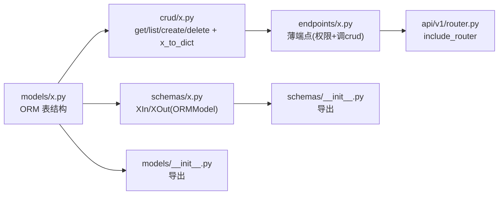

# 测试平台后端「目录结构与模块职责」优化方案

> 架构师：高见远（software-architect）
> 阶段：仅方案设计，不写代码
> 关联文档：`docs/refactor-design.md`（12 处重复样板封装）
> 基线：`tests/` 37 个测试方法，行为不变

---

## 一、现状诊断

### 1.1 总体结论：目录布局本身已接近「标准 FastAPI 分层」，问题集中在「文件内职责混杂」与「缺一层业务编排层」

当前 9 个顶层目录（`api/ core/ crud/ db/ jobs/ models/ schemas/ utils/`）是**惯用的 FastAPI 结构，方向正确**。真正的问题不是「目录错」，而是：

1. **端点文件在偷偷做「服务层」的事**——跨多表编排、状态机、MinIO+DB 复合写入被塞进 `endpoints/*.py`，导致 `agents.py`(277)、`environments.py`(240)、`tasks.py`(229) 越来越大且不可复用。
2. **纯函数散落在端点里**——`_registration_command`(生成 docker 命令)、`_strip_archive_root`、`_normalize_selected_case_paths` 本质是无 DB 依赖的纯函数，却写在端点模块内。
3. **缺两个「样板封装」落点**——上一轮已设计的 `api/helpers.py` + `crud/common.py`（详见 refactor-design.md）正好补齐。

### 1.2 逐文件职责混杂清单

| 文件（行数） | 实际承担的职责（已混杂） | 是否该拆 |
|---|---|---|
| `api/v1/endpoints/agents.py`(277) | ①Agent 认证 ②WebSocket 连接 ③心跳/命令租约事件分发 ④**业务状态机** `_finish_command`（改 Deployment/Environment/Task/TaskResult）⑤下载框架 ⑥**打包项目 zip** ⑦产物上传 | **是**：④ 状态机应下沉 service，⑥ 打包应入 utils |
| `api/v1/endpoints/environments.py`(240) | ①CRUD 端点 ②**生成 Agent 注册 docker 命令** `_registration_command` ③overview 聚合 ④框架文件校验 `_framework_file` ⑤更新状态刷新 `_refresh_update_state` | **是**：② 入 utils，③ 入 service，④⑤ 已在 #11/#9 处理 |
| `api/v1/endpoints/tasks.py`(229) | ①CRUD 端点 ②**用例路径归并** `_normalize_selected_case_paths` ③环境就绪校验 `_ready_environment` ④创建/重跑编排（冻结快照+入队） | **是**：② 入 utils，④ 入 service |
| `api/v1/endpoints/frameworks.py`(169) | ①列表/详情/下载/删除 ②**上传编排**（校验+包检视+版本定位+文件 upsert） | **是**：② 入 service |
| `api/v1/endpoints/project_files.py`(172) | ①文件 CRUD ②`_save_project_file`(MinIO+DB 复合) ③`_strip_archive_root` ④批量/归档上传编排 | **是**：③ 入 utils，②④ 视情况入 service |
| `api/v1/endpoints/deployments.py`(93) | ①部署编排 `deploy_framework`(校验+入队+写库+Redis日志) ②list/logs | 中等：① 可入 service |
| `crud/command.py`(121) | enqueue + renew lease + lease + match（同一 AgentCommand 生命周期域） | **否**：内聚，121 行不拆 |
| `db/migrations.py`(166) | 多个自研迁移函数集中管理 | **否**：集中式迁移是优点，不拆 |
| `core/security.py`(77) | 密码 + JWT + Agent 令牌（同属认证加密域） | **否**：77 行内聚 |
| `core/storage.py`(86) | 单一 MinIO 适配器 | **否**：单一职责清晰 |
| 其余端点（auth/users/projects/project_members/task_results/streams） | 各自单一、行数适中 | **否** |

> 结论：**只需新增 1 个目录（`services/`）+ 2 个文件（`helpers.py`/`common.py`，上轮已定）+ 把 4~5 个纯函数归位到 `utils/`**，即可达成「每个文件各尽其责」，无需大动 9 个既有目录。

---

## 二、优化目标与原则

1. **单一职责**：一个文件只做一类事；端点薄、编排入 service、数据入 crud、纯函数入 utils。
2. **按领域聚合**：`models/schemas/crud/endpoints` 四层按同一业务实体（resource/task/environment/user/command）一一对应命名。
3. **依赖单向向下**：`api → services → crud → models`；`crud/services 不 import fastapi`；`utils 不 import db/fastapi`。
4. **不破坏公开 import**：`tests/` 直接 import 的符号（`app.crud.task.task_to_dict`、`app.api.deps.ensure_project_access`、`app.api.v1.endpoints.tasks.create_task` 等）其「模块路径+函数名+签名」保持稳定；确需移动时用 re-export 垫片。
5. **扩展零手写**：新增实体遵循固定模板（见第五节），字段新增自动流经 `model_to_dict` + `from_attributes`。

---

## 三、优化后目录结构

> 标注：`【新】` 为本次新增；其余为既有文件，仅内部职责调整。

```
backend/app/
├── __init__.py
├── app.py                        # FastAPI 实例 + lifespan，只做装配（中间件/路由/后台循环），无业务
│
├── api/                          # HTTP 接入层
│   ├── __init__.py
│   ├── deps.py                   # 认证/授权依赖：current_user / require_roles / admin / ensure_project_access
│   ├── helpers.py                # 【新】HTTP 样板：get_or_404 / commit_or_conflict / ensure_no_tasks / download_response / get_accessible_project
│   └── v1/
│       ├── __init__.py
│       ├── router.py             # 唯一路由聚合点，所有 include_router 集中于此
│       └── endpoints/            # 每文件 = 一组资源端点（薄：校验 + 权限 + 调 service/crud + 组装响应）
│           ├── __init__.py
│           ├── auth.py           # 登录 / me / 改密
│           ├── users.py          # 用户 CRUD
│           ├── projects.py       # 项目 CRUD + 项目任务列表
│           ├── project_files.py  # 项目文件上传/下载/删除
│           ├── project_members.py# 项目成员管理
│           ├── frameworks.py     # 框架上传/查询/下载/删除
│           ├── environments.py   # 执行器 CRUD + 注册 + overview
│           ├── deployments.py    # 部署 + 部署日志
│           ├── tasks.py          # 任务 CRUD + 取消/重跑
│           ├── task_results.py   # 任务结果/产物查询下载
│           ├── agents.py         # Agent 通信（认证/WS/下载/上传），状态机下沉 service
│           └── streams.py        # 任务日志 WebSocket
│
├── services/                     # 【新】业务编排层（跨实体/状态机/复合写入），不 import fastapi
│   ├── __init__.py
│   ├── task_lifecycle.py         # 创建/重跑/取消任务：冻结快照 + 入队命令 + 状态流转
│   ├── command_finish.py         # _finish_command：命令完成→部署/任务终态迁移 + 结果落库
│   ├── deployment_service.py     # 部署编排：校验 + 建部署记录 + 入队 + Redis 日志
│   └── framework_service.py      # 框架上传编排：校验 + 包检视 + 版本定位 + 文件 upsert
│
├── crud/                         # 数据访问层（纯 SQLAlchemy，不 import fastapi）
│   ├── __init__.py
│   ├── common.py                 # 【新】model_to_dict / remove_resource_files
│   ├── command.py                # AgentCommand 生命周期（enqueue/lease/renew/match）
│   ├── environment.py            # Environment 查询/计数 + environment_to_dict 适配器
│   ├── resource.py               # Resource/ResourceFile/Member 查询 + framework_out
│   ├── task.py                   # Task 查询 + task_select_with_names + task_to_dict 适配器
│   └── user.py                   # User 查询
│
├── models/                       # ORM 模型（只放表结构/约束，无业务逻辑）
│   ├── __init__.py
│   ├── command.py                # AgentCommand
│   ├── environment.py            # Environment / Deployment
│   ├── resource.py               # Resource / ResourceFile / ResourceMember
│   ├── task.py                   # Task / TaskFile / TaskResult / TaskArtifact
│   └── user.py                   # User
│
├── schemas/                      # Pydantic 请求/响应模型
│   ├── __init__.py
│   ├── base.py                   # ORMModel(from_attributes=True)
│   ├── auth.py                   # LoginIn/TokenOut/PasswordChange
│   ├── environment.py            # EnvironmentIn/Out/OverviewOut/DeploymentOut/AgentRegistrationOut
│   ├── resource.py               # ResourceCreate/Out/FileOut/FrameworkOut/MemberItem
│   ├── task.py                   # TaskCreate/Out/ResultOut/ArtifactOut
│   └── user.py                   # UserCreate/Update/Out
│
├── core/                         # 横切基础设施（无业务状态）
│   ├── __init__.py
│   ├── config.py                 # Settings（pydantic-settings）
│   ├── redis.py                  # 同步/异步 Redis 客户端
│   ├── security.py               # 密码摘要 / JWT / Agent 令牌
│   └── storage.py                # MinIO 适配器（put/get/remove/ensure_buckets）
│
├── db/                           # 数据库基础设施
│   ├── __init__.py
│   ├── base.py                   # DeclarativeBase + utcnow()
│   ├── session.py                # engine + SessionLocal + get_db
│   ├── migrations.py             # 自研幂等迁移（集中管理，一个迁移一个函数）
│   └── init_db.py                # 建表 + 迁移挂载 + 桶初始化 + 管理员种子
│
├── jobs/                         # 后台定时任务
│   ├── __init__.py
│   ├── lifecycle.py              # 维护循环调度（asyncio）
│   └── maintenance.py            # 单轮维护：离线/超时/租约恢复/日志 TTL
│
└── utils/                        # 纯函数工具（不 import db / fastapi）
    ├── __init__.py
    ├── archive.py                # 归档读取 + strip_archive_root(迁入)
    ├── framework_package.py      # 框架包检视
    ├── hashing.py                # sha256
    ├── ini.py                    # INI 校验
    ├── paths.py                  # 相对路径校验 + case_paths 归并(迁入)
    └── agent_command.py          # 【新】生成 Agent 注册 docker 命令(迁入 _registration_command)
```

---

## 四、模块职责边界（该放什么 / 不该放什么）

| 模块 | 该放 | 不该放 |
|---|---|---|
| `models/` | ORM 表结构、列类型、约束、索引 | 查询逻辑、业务校验、HTTP 异常、to_dict |
| `schemas/` | Pydantic 请求/响应模型、字段校验 | ORM 查询、DB 访问、业务编排 |
| `crud/` | select/join/聚合/insert、to_dict 适配器（用 model_to_dict）、计数 | import fastapi、抛 HTTPException、MinIO 业务编排（除 remove_resource_files 这类资源清理复合件）、跨多域状态机 |
| `services/` | 跨实体编排、状态机（命令完成→终态）、复合写入（冻结快照+入队）、文件上传编排 | 路由/依赖、`db.scalars` 之外重复造轮子（可下沉 crud 的原子查询仍归 crud）、import fastapi |
| `api/endpoints/` | 参数校验、权限依赖、调 service/crud、组装响应、HTTP 状态语义 | `db.scalars(select(...))`、状态机、纯函数（应归 utils）、MinIO 直连 |
| `api/deps.py` | 认证/授权依赖、角色 gate | 业务查询、样板 helper（应归 helpers） |
| `api/helpers.py` | HTTP 样板（404/409/下载/复合权限） | 纯数据（归 crud/common）、状态机 |
| `core/` | config/redis/security/storage 等横切基础设施 | 业务模型语义、领域规则 |
| `db/` | engine/session/migrations/init | 业务查询、领域逻辑 |
| `jobs/` | 定时维护循环与单轮逻辑 | 端点、HTTP 语义 |
| `utils/` | 纯函数（无 DB/HTTP 依赖） | 数据库访问、import fastapi、依赖 settings 之外的全局态 |

---

## 五、扩展路径指引（新增业务实体 X）

### 5.1 标准模板（按最少代码量排序）



### 5.2 分步清单

1. **`models/x.py`**：定义 `class X(Base)` 表结构 + `__table_args__`（唯一约束）；在 `models/__init__.py` 加 `from app.models.x import X` 并加入 `__all__`。
2. **`schemas/x.py`**：`XIn(BaseModel)`（请求）+ `XOut(ORMModel)`（响应）；在 `schemas/__init__.py` 导出。
3. **`crud/x.py`**：`get_x`/`list_x`/`create_x`/`update_x`/`delete_x` + `x_to_dict`（内部调 `crud/common.model_to_dict`）。**不 import fastapi**。
4. **`api/v1/endpoints/x.py`**：定义 `router = APIRouter(prefix=..., tags=...)`，端点内用 `get_or_404` / `commit_or_conflict` / `ensure_no_tasks` / `remove_resource_files`，`Depends(admin/current_user)` 控制权限。
5. **`api/v1/router.py`**：`api_router.include_router(x.router)`。
6. **如需新表/新列**：`db/migrations.py` 加一个幂等函数（`ADD COLUMN IF NOT EXISTS`），并在 `db/init_db.py` 的 `initialize_database()` 挂载。
7. **如需跨实体编排/状态机**：新建 `services/x_service.py`，端点调 service。
8. **如需文件存储**：复用 `core/storage.py`，删除时用 `crud/common.remove_resource_files`。
9. **纯校验/转换**：放 `utils/`。
10. **测试**：`tests/test_x.py`，验证 to_dict 通过 `XOut.model_validate`、权限 gate、409/404 语义。

### 5.3 「最少代码」示例（简单资源，无 join）

新增一个只含基础字段、无名称化 join 的资源，全套样板可控制在 **约 50~60 行**：

```python
# crud/x.py
def list_x(db): return db.scalars(select(X).order_by(X.id)).all()
def get_x(db, xid): return db.get(X, xid)
# endpoints/x.py
@router.get("", response_model=list[XOut])
def list_x(db=Depends(get_db)): return list_x(db)          # from_attributes 直出
@router.post("", response_model=XOut, status_code=201)
def create_x(data: XIn, _=Depends(admin), db=Depends(get_db)):
    item = X(**data.model_dump()); db.add(item)
    with commit_or_conflict(db, "X 名称已存在"): pass
    db.refresh(item); return item
```

字段新增时：`models` + `schemas/XOut` + （若走 model_to_dict）自动流入，端点/crud 零改动。

---

## 六、与已有封装方案（refactor-design.md）的整合

本目录方案与上轮「12 处重复抽取」是一体两面：

| 上轮封装 | 本目录落点 | 整合效果 |
|---|---|---|
| `get_or_404` / `commit_or_conflict` / `ensure_no_tasks` / `download_response` / `get_accessible_project` | `api/helpers.py`【新】 | 端点变薄，HTTP 样板归位 |
| `model_to_dict` / `remove_resource_files` | `crud/common.py`【新】 | 数据组装与资源清理归位，`task_to_dict`/`environment_to_dict`/`framework_out` 变薄壳 |
| #2/#3/#4/#6/#7 机械替换 | 各 endpoints | 直接减少端点行数 |
| #8 crud 边界收口 | 新增 `services/` 前，list_* 先下沉 crud | 端点不再直写 select |
| #11 `_framework_file`、#9 `_refresh_update_state` | 归 `crud/`（或 `services/`） | 消除 environments/deployments 重复 |

**整合后的完整分层**（自上而下）：

```
endpoints(薄)  →  api/helpers(HTTP样板) + api/deps(权限)
        ↓ 调
services(编排/状态机)  →  crud/*(数据访问)  →  crud/common(组装/清理)
        ↓ 依
models(表结构) + schemas(契约) + core(基础设施) + utils(纯函数)
```

依赖方向严格向下；`services/crud/utils` 均不依赖 `fastapi`，可独立单测。

---

## 七、改造优先级与风险

### 7.1 分级

| 级别 | 动作 | 风险 | 是否动测试 import |
|---|---|---|---|
| **P0（零风险，立即做）** | 新增 `api/helpers.py`、`crud/common.py`、`services/__init__.py`（空）、`utils/agent_command.py`（纯新增） | 无（纯新增文件，不删不挪） | 否 |
| **P1（低风险）** | 纯函数归位：`_registration_command`→`utils/agent_command.py`、`_strip_archive_root`→`utils/archive.py`、`_normalize_selected_case_paths`→`utils/paths.py`；端点改 import | 低（仅移动私有 `_` 函数，tests 不引用） | 否 |
| **P2（需谨慎）** | 引入 `services/` 并拆分：`agents.py` 的 `_finish_command`→`services/command_finish.py`、`tasks.py` 创建/重跑/取消→`services/task_lifecycle.py`、`frameworks.py` 上传编排→`services/framework_service.py`、`deployments.py` 部署→`services/deployment_service.py` | 中（移动代码，端点函数保留为薄壳，签名不变） | 否（tests 调端点函数） |
| **P2（不建议本次）** | `app.py`→`main.py` 重命名 | 中（需改 `Dockerfile` CMD `app.app:app` 及任何引用） | 否，但收益低，建议保持 |

### 7.2 回归保障（37 测试不回归）

`tests/` 直接 import 的**公开符号**（这些「模块路径 + 函数名 + 签名」是硬约束）：

| 测试 import | 约束 |
|---|---|
| `app.schemas.*`（EnvironmentIn/ResourceCreate/UserCreate/TaskCreate/各 Out） | schema 类名/字段不变 |
| `app.crud.command`（lease_commands/renew_active_leases） | 函数路径不变 |
| `app.crud.environment.environment_to_dict`、`app.crud.task.task_to_dict` | 函数路径+签名不变（上轮已约定薄壳保留） |
| `app.api.deps`（ensure_project_access/require_roles） | 路径不变 |
| `app.api.v1.endpoints`（deployments/environments/frameworks/projects/tasks 的端点函数） | 端点函数签名不变 |
| `app.db.migrations.migrate_environment_governance`、`app.db.init_db.initialize_database` | 路径不变 |

保障手段：
1. **services 抽取时端点函数保留为薄壳**（`def create_task(...): return task_lifecycle.create(...)`），tests 调端点函数照常通过。
2. 若必须移动公开函数（当前无此需求），用 re-export 垫片保留旧 import 路径。
3. 每完成一个 P 级，全量 `pytest`；P2 拆分采用「逐函数迁移 + 逐次跑测试」。
4. 部署侧无风险：`scripts/deploy_backend.py` 是递归上传 `backend/app` 下所有 `.py`（`collect_files` 走 os.walk），新增目录/文件自动纳入上传，无需改部署脚本。

---

## 八、待明确事项

1. **是否引入 `services/` 层**：本方案推荐引入（把 `_finish_command`/任务编排/框架上传/部署编排从端点抽出）。若团队倾向「更保守、不加新目录」，可退化为「只加 helpers/common + 纯函数归位，端点内保持薄编排」。请拍板采用推荐版还是保守版。
2. **`services/` 的粒度**：是按「业务域」分文件（task_lifecycle/command_finish/deployment_service/framework_service）还是先合并为 1~2 个文件（如 `services/orchestration.py`）再按需拆分？建议先按域分 4 个，职责更清晰。
3. **`app.py` 是否重命名 `main.py`**：建议**不重命名**（收益低、需改 Dockerfile CMD）。
4. **`crud/command.py` 是否拆 enqueue/lease**：建议**不拆**（121 行内聚，属同一生命周期域）。
5. **`schemas/environment.py` 是否随 service 拆分进一步拆**（AgentRegistrationOut 等归独立文件）：建议暂不拆（schema 按业务实体聚合已足够）。

---

## 执行摘要（≤150 字）

现状 9 目录分层方向正确，问题在端点文件职责混杂（agents/environments/tasks 把状态机、编排、纯函数塞进端点）。方案：新增 services/ 业务编排层（task_lifecycle/command_finish/deployment/framework），纯函数归位 utils，加上轮 api/helpers.py 与 crud/common.py，端点变薄。依赖单向向下，扩展走固定模板（models→schemas→crud→endpoints→router）。P0 纯新增零风险，P1 移纯函数，P2 拆大文件需谨慎，37 测试为回归基线。
