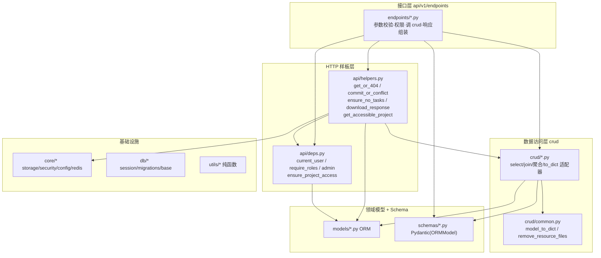
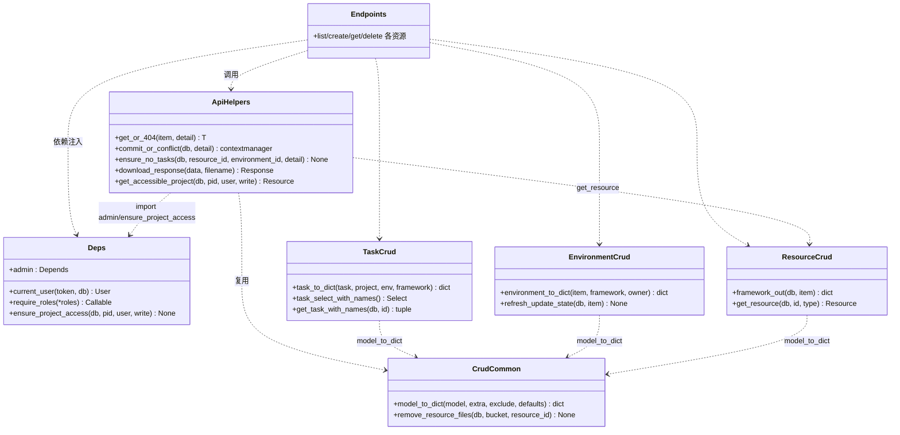
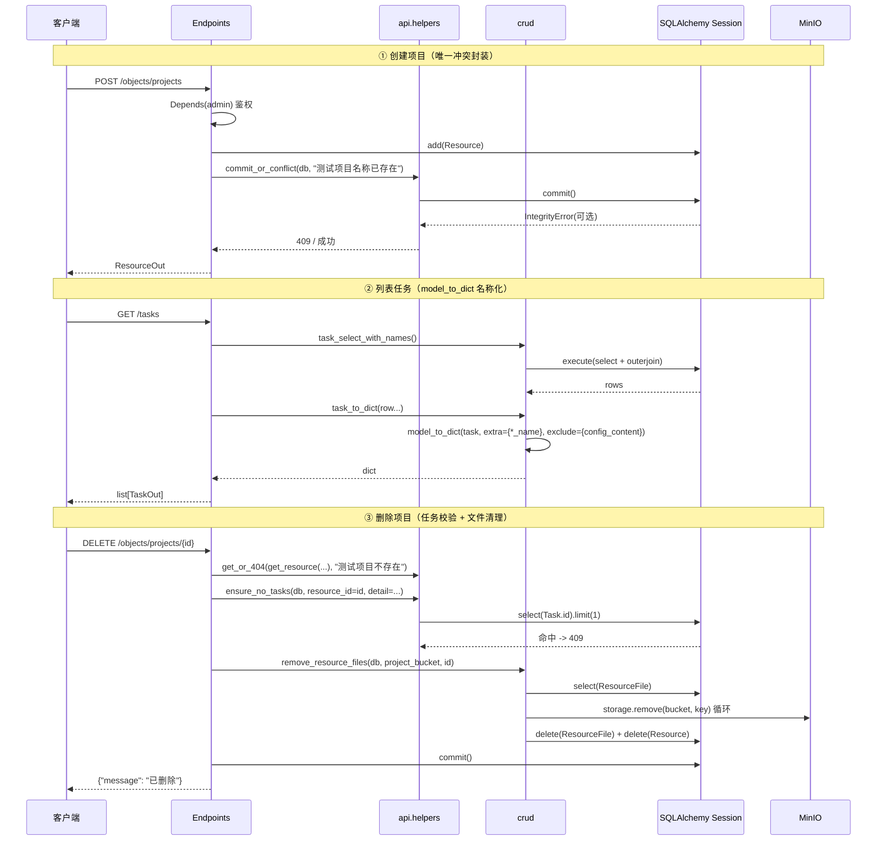
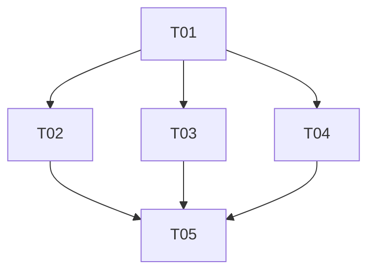

# 测试平台后端「公共封装提取」架构分析与改造设计

> 架构师：高见远（software-architect）
> 阶段：仅分析设计，不写代码
> 范围：后端 `backend/app` 全量样板代码去重 + 分层收口
> 基线：`tests/` 现有 37 个测试方法（`test_core.py` 14 个 + `test_governance.py` 23 个）作为行为不变回归基线

---

## 〇、实现思路（Implementation Approach）

### 难点与取舍

本阶段是**纯重构**：技术栈、数据模型、API 路径、响应字段全部不可变，唯一目标是**减少后续业务开发要手写的样板代码**。核心难点有三：

1. **名称化 join 字段**（`project_name/framework_name/owner_name/used_by_count`）无法被 `ORMModel(from_attributes=True)` 自动读取，逼出 3 处手写 `to_dict`（20 字段级）。这是「重复造轮子」的**根因**，必须用「SQLAlchemy 列自动提取 + extra 叠加」的通用 `model_to_dict` 根治。
2. **HTTP 语义样板**（404/409/下载响应）散落在各端点，属于「可安全机械替换」的零风险封装。
3. **crud 层与端点层边界模糊**（端点直接 `db.scalars(select(...))`），导致同一查询逻辑无法复用。

### 框架与选型（无新增依赖）

| 关注点 | 选型 | 理由 |
|---|---|---|
| 列自动提取 | SQLAlchemy `inspect(model).mapper.column_attrs` | 只枚举**列**（不含 relationship，不触发惰性加载），JSON 列已反序列化为 Python 对象，无需手写 |
| HTTP 异常 | 复用 `fastapi.HTTPException` | 与现有错误码/消息完全一致 |
| 唯一冲突 | 复用 `sqlalchemy.exc.IntegrityError` | 数据库唯一约束是唯一可靠的并发兜底 |
| 下载响应 | 复用 `fastapi.responses.Response` + `urllib.parse.quote` | 与现有 `filename*=UTF-8''...` 完全一致 |

**结论：不引入 Alembic、不引入 fastapi-crudrouter、不引入泛型仓储基类。** 现有「函数式 crud + ORMModel」风格足够，新增两个轻量模块即可（详见第三节）。

### 三条设计原则

1. **函数名/签名不变**（`task_to_dict`、`environment_to_dict` 等对外符号保留），内部改为 `model_to_dict` 薄封装，保证 `test_governance.py` 现有断言零修改通过。
2. **crud 层保持纯数据访问，不 import fastapi**；HTTP 异常统一收敛到 `api/helpers.py`。
3. **先零风险机械替换（P0），再语义重构（P1/P2）**，每步可用 37 个测试回归。

---

## 一、重复点总表（逐条验证 + 补全）

> 结论：team-lead 给出的 10 条**全部属实**，但部分出现次数被低估；另补充 2 条未列出的重复点（#11、#12）。

| 编号 | 重复模式 | 出现位置（文件:函数，行号基于当前源码） | 出现次数 | 严重度 |
|---|---|---|---|---|
| 1 | 「读取或 404」 | `projects.py:_project`、`project_files.py:_project`（与前者逐字重复）、`frameworks.py:_framework`、`environments.py:_environment`、`deployments.py:_environment`（与 environments 逐字重复）、`users.py:update_user`(内联 `db.get(User)`→404)、`task_results.py:_task`、`tasks.py:_task`（与 task_results 逐字重复）、`project_members.py:_ensure_project` | **9** | 高 |
| 2 | `try commit except IntegrityError → 409` | `projects.py:create_project`("测试项目名称已存在")、`environments.py:create_environment`("环境名称已存在")、`users.py:create_user`("用户名已存在") | 3 | 中 |
| 3 | 删除前任务校验→409 | `projects.py:delete_project`、`frameworks.py:delete_framework`（均用 `or_(Task.project_id==id, Task.framework_id==id)`）、`environments.py:delete_environment`（`Task.environment_id==id`） | 3 | 中 |
| 4 | MinIO 清理 + 删除 ResourceFile | `projects.py:delete_project`、`frameworks.py:delete_framework`（遍历 files→`storage.remove`→delete ResourceFile，仅 bucket 不同） | 2 | 中 |
| 5 | 手动 `to_dict` 组装 | `crud/task.py:task_to_dict`(19 字段)、`crud/environment.py:environment_to_dict`(22 字段)、`frameworks.py:_framework_out`(11 字段) | 3（根因） | **高** |
| 6 | `admin = require_roles("admin")` 每文件重复 | `projects.py:17`、`environments.py:21`、`frameworks.py:22`、`users.py:14`、`deployments.py:17`、`project_members.py:13` | **6**（非 4） | 低 |
| 7 | 下载 `Content-Disposition` 构造 | `project_files.py:download_project_file`、`frameworks.py:download_framework`、`task_results.py:download_artifact` | 3 | 低 |
| 8 | 端点直写 `db.scalars(select(...))` | `projects.py:list_projects`、`frameworks.py:list_frameworks`、`users.py:list_users`、`project_files.py:list_project_files`、`task_results.py:task_results/task_artifacts`、`deployments.py:list_deployments` | 6+ | 中 |
| 9 | `_refresh_update_state` + `db.commit()` 重复 | `environments.py:list_environments/read_environment/environment_overview` | 3 | 低 |
| 10 | `ensure_project_access` + `_project` 两行组合 | `project_files.py` 6 处(list/upload/upload_archive/update/download/delete)、`projects.py` 2 处(get_project/list_project_tasks) | 8 | 中 |
| 11（补充） | `_framework_file`（读已启用框架+归档）重复 | `environments.py:43`、`deployments.py:29`（语义相同，仅报错文案略异） | 2 | 低 |
| 12（补充） | `ACTIVE_TASK_STATUSES` 常量重复 | `crud/environment.py:7`、`jobs/maintenance.py:13` | 2 | 低 |

> 补充说明 #3：`delete_framework` 除「任务校验」外还多一道「正在被执行环境使用」校验（`Environment.framework_id==id`），该逻辑**不属于**任务校验范畴，抽取时保留在端点内，不并入 `ensure_no_tasks`。

---

## 二、公共封装设计

### 放置位置总原则

新增两个轻量模块，按「是否抛 HTTPException / 是否返回 Response」划分：

- **`backend/app/api/helpers.py`（新）**：HTTP 关注点，可 import `fastapi`、`app.models`、`app.core.storage`、`app.api.deps`。放 `get_or_404` / `commit_or_conflict` / `ensure_no_tasks` / `download_response` / `get_accessible_project`。
- **`backend/app/crud/common.py`（新）**：数据关注点，**不 import fastapi**（保持可单测），只 import `sqlalchemy`、`app.models`、`app.core.storage`。放 `model_to_dict` / `remove_resource_files`。
- **`backend/app/api/deps.py`（改）**：导出 `admin = require_roles("admin")`。

---

### 2.1 「读取或 404」→ `get_or_404(item, detail)`

```python
# app/api/helpers.py
from typing import TypeVar
from fastapi import HTTPException

T = TypeVar("T")

def get_or_404(item: T | None, detail: str) -> T:
    """item 为 None 抛 404，否则返回 item（静态类型收窄）。"""
    if item is None:
        raise HTTPException(status_code=404, detail=detail)
    return item
```

**为什么签名是 `(item, detail)` 而非 `(db, model, ident, detail)`**：当前各处的「取数」并非都是 `db.get(Model, id)`——`get_resource(db, id, "project")` 带资源类型校验、`get_file` 带归属校验、`get_task` 是普通 get。把「取数」留在 crud，把「None→404」交给 helper，才能覆盖全部 9 处而不丧失各自的取数语义。

**使用示例**：

```python
# projects.py
def _project(db, project_id):
    return get_or_404(get_resource(db, project_id, "project"), "测试项目不存在")

# users.py::update_user
user = get_or_404(db.get(User, user_id), "用户不存在")

# tasks.py::_task
task = get_or_404(crud_get_task(db, task_id), "任务不存在")
```

> `tasks.py:_task` / `task_results.py:_task` 还包含 `ensure_project_access`，属 #10，见 2.10。

---

### 2.2 「唯一冲突」→ `commit_or_conflict(db, detail)` 上下文管理器

```python
# app/api/helpers.py
from contextlib import contextmanager
from sqlalchemy.exc import IntegrityError
from sqlalchemy.orm import Session

@contextmanager
def commit_or_conflict(db: Session, detail: str):
    """提交事务；捕获 IntegrityError 统一 rollback + 抛 409。"""
    try:
        yield
        db.commit()
    except IntegrityError:
        db.rollback()
        raise HTTPException(status_code=409, detail=detail)
```

**使用示例**：

```python
# projects.py::create_project
item = Resource(resource_type="project", name=data.name, metadata_json={}, created_by=user.id)
db.add(item)
with commit_or_conflict(db, "测试项目名称已存在"):
    pass          # 或 with 内无语句，提交发生在退出时
db.refresh(item)
```

> 可选微调：`commit_or_conflict(db, detail, refresh=item)` 把 `db.refresh` 也纳入，进一步收敛样板。建议保留 `refresh` 在端点内（保持事务语义显式）。

---

### 2.3 「删除前任务校验」→ `ensure_no_tasks(db, ...)`

```python
# app/api/helpers.py
from sqlalchemy import or_, select
from app.models import Task

def ensure_no_tasks(db: Session, *, resource_id: int | None = None,
                    environment_id: int | None = None, detail: str) -> None:
    """任一维度存在任务记录即抛 409。

    resource_id 面向「对象资源」(project/framework 共表 object_resources)，
    校验 or_(Task.project_id==id, Task.framework_id==id)；environment_id 面向执行器。
    """
    conds = []
    if resource_id is not None:
        conds.append(or_(Task.project_id == resource_id, Task.framework_id == resource_id))
    if environment_id is not None:
        conds.append(Task.environment_id == environment_id)
    if conds and db.scalar(select(Task.id).where(or_(*conds)).limit(1)):
        raise HTTPException(status_code=409, detail=detail)
```

**使用示例**：

```python
# projects.py::delete_project
ensure_no_tasks(db, resource_id=item.id, detail="测试项目已有任务记录，不能删除")

# environments.py::delete_environment
ensure_no_tasks(db, environment_id=item.id, detail="环境已有任务记录，请停用环境")
```

---

### 2.4 「MinIO 清理 + 删记录」→ `remove_resource_files(db, bucket, resource_id)`

```python
# app/crud/common.py
from sqlalchemy import delete, select
from sqlalchemy.orm import Session
from app.core.storage import storage
from app.models import ResourceFile

def remove_resource_files(db: Session, bucket: str, resource_id: int) -> None:
    """删除资源全部 MinIO 对象及其 ResourceFile 记录（不 commit）。"""
    files = db.scalars(select(ResourceFile).where(ResourceFile.resource_id == resource_id)).all()
    for file in files:
        storage.remove(bucket, file.object_key)
    db.execute(delete(ResourceFile).where(ResourceFile.resource_id == resource_id))
```

**使用示例**：

```python
# projects.py::delete_project
remove_resource_files(db, settings.project_bucket, item.id)
# frameworks.py::delete_framework
remove_resource_files(db, settings.framework_bucket, item.id)
```

> 说明：该函数**不 commit**，交由端点统一 `db.commit()`（与现状一致，删除 `Resource` 行与文件清理在同一事务）。

---

### 2.5 「手动 to_dict」→ 通用 `model_to_dict`（**核心设计**）

#### 签名与实现草图

```python
# app/crud/common.py
from typing import Any
from sqlalchemy import inspect as sa_inspect

def model_to_dict(
    model: object,
    extra: dict[str, Any] | None = None,      # join 名称化字段 / 反向计数
    exclude: set[str] | None = None,          # 敏感/内部字段
    defaults: dict[str, Any] | None = None,   # 列值为 None 时的回退（如 tags -> []）
) -> dict[str, Any]:
    """把 SQLAlchemy 实例自动组装为响应字典，零手写列字段。

    - 用 inspect(model).mapper.column_attrs 枚举全部列（不含 relationship，不触发惰性加载）；
    - getattr 取值：JSON 列（metadata_json/tags/testcase_scope/selected_case_paths）
      已被 SQLAlchemy 反序列化为 Python dict/list，无需 JSON 解析；
    - exclude 剔除敏感字段；defaults 处理 None 归一化；extra 叠加（同名覆盖列值）。
    """
    cols = {attr.key: getattr(model, attr.key)
            for attr in sa_inspect(model).mapper.column_attrs}
    if defaults:
        for key, fallback in defaults.items():
            if cols.get(key) is None:
                cols[key] = fallback
    if exclude:
        for key in exclude:
            cols.pop(key, None)
    if extra:
        cols.update(extra)
    return cols
```

#### 三个适配器（**保留原函数名/签名，测试零改动**）

```python
# crud/task.py —— task_to_dict 改为 model_to_dict 薄封装
from app.crud.common import model_to_dict

def task_to_dict(task, project=None, environment=None, framework=None):
    return model_to_dict(
        task,
        exclude={"config_content"},          # 敏感：INI 配置不输出
        extra={
            "project_name": project.name if project else None,
            "environment_name": environment.name if environment else None,
            "framework_name": framework.name if framework else None,
        },
    )
```

```python
# crud/environment.py
def environment_to_dict(item, framework=None, owner=None):
    return model_to_dict(
        item,
        exclude={"agent_token_hash"},        # 敏感：Agent 令牌摘要
        defaults={"tags": []},               # 归一化，等价原 isinstance 防御
        extra={
            "owner_name": owner.username if owner else None,
            "framework_name": framework.name if framework else None,
            "framework_os": framework.os if framework else None,
            "framework_arch": framework.arch if framework else None,
        },
    )
```

```python
# crud/resource.py —— _framework_out 从端点迁入 crud，改名 framework_out
def framework_out(db, item):
    return model_to_dict(item, extra={"used_by_count": count_environments_by_framework(db, item.id)})
```

#### 与 `from_attributes` 的取舍评估（结论：**互补并存，不替代**）

| 场景 | from_attributes（现状） | model_to_dict（新） |
|---|---|---|
| 纯 ORM 直出（list_users/get_project/list_frameworks 的基础列） | ✅ 零代码 | ❌ 多余 |
| 需 join 名称化字段（`*_name`/`used_by_count`） | ❌ 拿不到，只能手写 dict | ✅ extra 叠加 |
| 需排除敏感列（`password_hash`/`agent_token_hash`/`config_content`） | ✅ schema 未声明字段默认忽略 | ✅ exclude 显式 |
| 需字段归一化（`tags None→[]`） | ❌ 需手写 | ✅ defaults |
| 新增模型列 | ✅ 自动 | ✅ 自动（两者都零手写） |

**最终约定**：
1. **无需 join/排除/归一化的端点**：继续 `response_model` + `from_attributes` 直出 ORM 对象（改造成本最小）。
2. **需 join/排除/归一化的端点**：走 `model_to_dict` 薄封装（保留 `task_to_dict`/`environment_to_dict`/`framework_out` 三个符号）。
3. **安全兜底**：`model_to_dict` 会输出全部列（含敏感列），因此所有适配器**必须显式 `exclude` 敏感列**；即便遗漏，`response_model`（Pydantic v2 默认 `extra='ignore'`）也会在序列化时丢弃 schema 未声明字段，不会泄露到 HTTP 响应。

> ⚠️ 这是本次重构**唯一需要逐字段核对**的改造点：替换后必须保证 `task_to_dict`/`environment_to_dict`/`framework_out` 输出字段集合与改造前**逐一相等**（列集合 + exclude + extra 的并集差集），详见第六节验证。

---

### 2.6 `admin` 统一导出

```python
# app/api/deps.py —— 在文件末尾统一导出
admin = require_roles("admin")
```

各端点删除本地 `admin = require_roles("admin")`，改 `from app.api.deps import admin`。

> 兼容性：`test_governance.py::test_framework_write_endpoints_require_admin` 断言 `"Depends(admin)" in inspect.getsource(fn)`——端点仍写作 `Depends(admin)`，故断言继续通过。

---

### 2.7 下载响应 → `download_response(data, filename)`

```python
# app/api/helpers.py
from urllib.parse import quote
from fastapi.responses import Response

def download_response(data: bytes, filename: str) -> Response:
    encoded = quote(filename)
    return Response(
        data,
        media_type="application/octet-stream",
        headers={"Content-Disposition": f"attachment; filename*=UTF-8''{encoded}"},
    )
```

**使用示例**：`download_framework` / `download_artifact` / `download_project_file` 三处改为 `return download_response(data, filename)`。

> 注意 `agents.py:download_framework` 用的是 `X-Content-SHA256` 头而非 `Content-Disposition`，是 Agent 内部通信，**不套用**此 helper。

---

### 2.8 crud 层与端点层边界约定

| 层 | 职责 | 禁止 |
|---|---|---|
| `api/v1/endpoints/*` | 参数/请求体校验（Pydantic 已做大半）、权限依赖（`Depends(admin)`/`current_user`/`ensure_project_access`）、调用 crud、响应组装（to_dict）、HTTP 状态语义 | **禁止**直接 `db.scalars(select(...))` |
| `crud/*` | 全部 select/join/聚合/insert 数据访问；返回 ORM 对象/元组/计数/to_dict | **禁止** import fastapi、抛 HTTPException |
| `api/helpers.py` | HTTP 语义样板（404/409/下载/复合权限） | — |
| `crud/common.py` | 纯数据公共件（model_to_dict/remove_resource_files） | **禁止** import fastapi |
| `core/`、`utils/` | 无业务状态的基础设施/纯函数 | 不碰业务模型语义 |

**落地动作**（#8）：`list_projects`/`list_frameworks`/`list_users`/`list_project_files`/`task_results`/`task_artifacts`/`list_deployments` 下沉为 crud 的 `list_xxx(db, ...)`，端点只做权限 + 调用。

---

### 2.9 `_refresh_update_state` + commit 收口

- 将 `_refresh_update_state` 从 `environments.py` 迁到 `crud/environment.py`（纯函数，不 commit，改名 `refresh_update_state(db, item)`）。
- 端点三处（list/read/overview）改为 `refresh_update_state(db, item); db.commit()`。

> **不建议**进一步封装成「refresh + commit」单函数：`db.commit()` 与「读路径写库」是既有语义，收口为一函数会让「读接口触发写」更隐蔽。此点列入「待明确事项」，本次只做纯迁移、不动语义。

---

### 2.10 `get_accessible_project` 复合封装（#10）

```python
# app/api/helpers.py
from app.api.deps import ensure_project_access
from app.crud.resource import get_resource
from app.models import Resource, User

def get_accessible_project(db: Session, project_id: int, user: User, write: bool = False) -> Resource:
    """读取项目(404) + 校验访问权限(403)，返回项目。"""
    project = get_or_404(get_resource(db, project_id, "project"), "测试项目不存在")
    ensure_project_access(db, project.id, user, write)
    return project
```

`project_files.py` 的 6 处、`projects.py` 的 2 处两行组合收敛为一行调用。

---

### 不建议抽取的点（避免过度封装）

1. **`current_user` 内的 401 校验**：已是唯一依赖，逻辑单一，不抽。
2. **`delete_framework` 的「正在被执行环境使用」校验**：只有 1 处，且语义独立，保留内联。
3. **`_normalize_selected_case_paths` / `_strip_archive_root` / `_filter_task_files`**：各只有 1 处、领域性强，抽取反而降低可读性。
4. **泛型 `commit_or_conflict` 扩展为「save_or_conflict(db, obj, detail)」**：不同创建点对 `db.add/flush` 的顺序需求不同（框架上传有 `flush` 拿 id），硬套一个「save」会掩盖差异，维持「只封装 commit 部分」。

---

## 三、目标架构分层图



---

## 四、数据结构与接口（classDiagram）



---

## 五、程序调用流程（sequenceDiagram）



---

## 六、文件清单（本次改造）

### 新增（2）

| 文件 | 内容 |
|---|---|
| `backend/app/api/helpers.py` | `get_or_404` / `commit_or_conflict` / `ensure_no_tasks` / `download_response` / `get_accessible_project` |
| `backend/app/crud/common.py` | `model_to_dict` / `remove_resource_files` |

### 修改（14）

| 文件 | 改动 |
|---|---|
| `backend/app/api/deps.py` | 导出 `admin` |
| `backend/app/api/v1/endpoints/projects.py` | #1/#2/#3/#4/#6/#8/#10 |
| `backend/app/api/v1/endpoints/project_files.py` | #1/#7/#10 |
| `backend/app/api/v1/endpoints/frameworks.py` | #1/#3/#4/#5(删 `_framework_out`)/#6/#7/#8 |
| `backend/app/api/v1/endpoints/environments.py` | #1/#2/#3/#6/#9/#11 |
| `backend/app/api/v1/endpoints/deployments.py` | #1/#6/#8/#11 |
| `backend/app/api/v1/endpoints/users.py` | #1/#2/#6/#8 |
| `backend/app/api/v1/endpoints/tasks.py` | #1(轻量) |
| `backend/app/api/v1/endpoints/task_results.py` | #1/#7/#8 |
| `backend/app/api/v1/endpoints/project_members.py` | #1/#6 |
| `backend/app/crud/task.py` | `task_to_dict` → `model_to_dict` 薄封装 |
| `backend/app/crud/environment.py` | `environment_to_dict` → `model_to_dict` 薄封装；迁入 `refresh_update_state` |
| `backend/app/crud/resource.py` | 迁入 `framework_out`；新增 `list_*` 下沉 |
| `backend/app/crud/user.py` | 可选：新增 `list_users` |

---

## 七、改造方案与优先级（P0/P1/P2）

| 级别 | 内容 | 风险 | 前置 |
|---|---|---|---|
| **P0（零风险可立即抽）** | #1 `get_or_404`、#2 `commit_or_conflict`、#3 `ensure_no_tasks`、#4 `remove_resource_files`、#6 `admin` 统一、#7 `download_response` | 纯新增 helper + 机械替换调用点，行为逐字节一致 | 新建 helpers/common 后即可 |
| **P1（需谨慎）** | #5 `model_to_dict` 替换 3 处手写 dict | **中高**：需逐字段核对 exclude/extra 并集差集，敏感列不得遗漏 | P0 的 helpers/common 落地后 |
| **P1（结构优化）** | #8 crud 边界收口（list_* 下沉）、#10 `get_accessible_project`、#11 `_framework_file`、#12 常量 | 低（纯移动/复用） | P0 |
| **P2（低优先/可延后）** | #9 `_refresh_update_state` 下沉（不动「读路径写库」语义） | 低 | P1 |

---

## 八、任务分解（有序，含依赖与验收标准）

> 说明：本阶段为存量重构，无脚手架配置，故 T01 以「新建公共封装基础设施（helpers/common/deps 导出）」承担从零项目的「基础设施」地基职责；T02/T03/T04 均仅依赖 T01，可并行。

| ID | 任务名 | 源文件 | 依赖 | 优先级 | 验收标准 |
|---|---|---|---|---|---|
| **T01** | 公共封装基础设施 | `api/helpers.py`(A)、`crud/common.py`(A)、`api/deps.py`(M) | — | P0 | 6 个 helper + `model_to_dict`/`remove_resource_files` 齐全；无循环 import；`crud/common.py` 不 import fastapi；无业务改动，37 测试全绿 |
| **T02** | 样板机械替换（读取404/冲突/删除校验/清理/下载/admin） | `endpoints/projects.py`、`endpoints/users.py`、`endpoints/environments.py`、`endpoints/frameworks.py`、`endpoints/deployments.py`、`endpoints/project_members.py`、`endpoints/task_results.py`、`endpoints/project_files.py` | T01 | P0 | 全部 #1/#2/#3/#4/#6/#7 调用点替换为 helper；错误码与文案不变；37 测试全绿 |
| **T03** | to_dict 通用化 | `crud/task.py`、`crud/environment.py`、`crud/resource.py`、`endpoints/frameworks.py`、`endpoints/environments.py`、`endpoints/tasks.py`、`endpoints/projects.py` | T01 | P1 | `task_to_dict`/`environment_to_dict`/`framework_out` 签名不变；输出字段与改造前逐一相等；`config_content`/`agent_token_hash` 不泄露；`test_governance` 名称化断言全绿 |
| **T04** | crud 边界收口 + 复合封装 | `endpoints/projects.py`、`endpoints/project_files.py`、`endpoints/frameworks.py`、`endpoints/users.py`、`endpoints/deployments.py`、`endpoints/task_results.py`、`crud/resource.py`、`crud/environment.py`、`api/helpers.py` | T01 | P1 | 所有 endpoint 不再出现 `db.scalars(select(...))`；`get_accessible_project` 覆盖 #10；37 测试全绿 |
| **T05** | 回归加固与收尾 | `tests/test_helpers.py`(A)、`tests/test_governance.py`(M 如需)、`docs/refactor-design.md`(M) | T02、T03、T04 | P2 | 为 `model_to_dict`/`get_or_404`/`commit_or_conflict`/`ensure_no_tasks` 补单元测试；全量 pytest 通过；设计文档与实现一致 |

**依赖图**：T02/T03/T04 仅依赖 T01，T05 依赖 T02+T03+T04，线性链仅 3 层。



---

## 九、依赖包列表（Required Packages）

**无新增依赖。** 全部复用现有 `fastapi`、`sqlalchemy`（`inspect`/`or_`/`func`）、`pydantic`、`minio`、`redis`、`jwt`。本次不改 `requirements` / `package.json`。

---

## 十、共享知识（Shared Knowledge）

```
1. 响应模型：ORM 直出用 ORMModel(from_attributes=True)；带 join/排除/归一化字段用
   crud/common.model_to_dict，且必须显式 exclude 敏感列（agent_token_hash/password_hash/config_content）。
2. 分层铁律：endpoints 禁止 db.scalars(select(...))；crud 禁止 import fastapi、禁止抛 HTTPException。
3. 唯一冲突统一走 commit_or_conflict(db, detail)，依赖数据库唯一约束兜底，不得先查后插。
4. 删除资源：先 ensure_no_tasks / 环境占用校验，再 remove_resource_files，最后统一 db.commit()。
5. 下载响应统一 download_response(data, filename)，Content-Disposition 用 filename*=UTF-8''quote(...)。
6. 迁移约定（不变）：幂等 ADD COLUMN IF NOT EXISTS；外键先 DROP CONSTRAINT IF EXISTS 再 ADD；挂 init_db.py。
7. 错误码语义（不变）：404 不存在 / 409 冲突与引用占用 / 422 参数非法 / 403 无权限 / 401 未认证。
8. 回归基线：tests/ 共 37 个测试方法，任何重构不得改变其断言行为。
```

---

## 十一、风险与回退

### 风险点

| 风险 | 等级 | 缓解 |
|---|---|---|
| `model_to_dict` 替换手写 dict 时字段集合漂移（多输出/漏输出/漏 exclude） | 高 | T03 单独成任务；替换后逐字段 diff；`test_governance` 已有 `TaskOut.model_validate`/`EnvironmentOut.model_validate` 做 Schema 边界兜底 |
| 敏感字段泄露（`config_content`/`agent_token_hash` 进入 dict） | 高 | 适配器显式 `exclude`；`response_model` extra='ignore' 二次兜底；T05 补显式断言「dict 不含敏感键」 |
| 循环 import（helpers→deps→…） | 中 | `helpers.py` 单向依赖 `deps.py`/`crud`；`deps.py` 不反向依赖 helpers；`crud/common.py` 零 fastapi 依赖 |
| `get_or_404` 类型收窄后返回值语义变化 | 低 | 仅包装 None 判断，无副作用 |
| 端点直写 select 下沉时误改查询语义（排序/过滤） | 中 | T04 仅「移动」select 语句，不改 where/order_by；用 37 测试 + 手工 diff 验证 |

### 回退策略

- **任务级回退**：T01~T05 各自独立可合并，任一任务出问题可 `git revert` 该任务提交，其余任务不受影响（因仅依赖 T01 地基）。
- **最小回退单位**：`model_to_dict` 若字段核对失败，可保留薄封装壳、内部回退为原手写 dict（函数签名不变，调用方无感）。
- **验证手段**：
  1. 全量 `pytest`（37 测试作为行为不变的硬基线）。
  2. 对 `task_to_dict`/`environment_to_dict`/`framework_out` 在重构前后分别 `print(dict)` 做字段集合与值逐项 diff（建议工程师在 T03 自测时执行一次）。
  3. 启动后手动冒烟：创建项目/环境/用户（唯一冲突 409）、删除项目/框架（引用占用 409）、下载框架/产物（Content-Disposition）、任务列表（名称字段）。

---

## 十二、待明确事项（需用户拍板）

1. **`model_to_dict` 与 `from_attributes` 的分工**：本设计主张「并存互补」——简单场景继续 `from_attributes` 直出，复杂场景用 `model_to_dict`。若用户希望「全面统一用 `model_to_dict`、废弃 from_attributes 直出」，需额外评估纯 ORM 直出端点（list_users/get_project 等）的改造面。请确认采用「并存」。
2. **是否引入 `BaseRepository` 泛型仓储基类 / `fastapi-crudrouter`**：**建议均不引入**。现有函数式 crud + 两个轻量模块已覆盖需求；引入会带来与 ORMModel、自研迁移、函数式风格的范式冲突，收益有限。请确认「不引入」。
3. **敏感字段是否全局黑名单**：本设计采用「每个适配器显式 `exclude`」而非全局黑名单（避免误伤未来需要暴露的字段）。请确认接受显式方案。
4. **`_refresh_update_state` 的「读路径写库」语义**（GET 触发 `db.commit` 修改 `deploy_status`）：本次仅做纯迁移、不动语义；是否要顺带改造为「读不写库 / 后台任务同步」，请拍板是否列入后续迭代。
5. **`delete_framework` 的「正在被执行环境使用→409」与 `ensure_no_tasks` 的关系**：本设计保留其独立内联（语义不同、仅 1 处）。如希望与「任务校验」合并为一个 `assert_deletable_resource(db, ...)`，需确认合并后的错误优先级（先报「环境占用」还是「任务占用」）。
6. **新模块命名**：`api/helpers.py` + `crud/common.py` 是否符合团队命名习惯，是否需要改为 `api/utils.py` / `crud/base.py`。

---

## 执行摘要（≤200 字）

对后端 12 处重复样板做公共封装：新增 `api/helpers.py`（get_or_404、commit_or_conflict、ensure_no_tasks、download_response、get_accessible_project）与 `crud/common.py`（model_to_dict、remove_resource_files）；核心是用 SQLAlchemy `column_attrs` 自动提取列 + `extra/exclude/defaults` 叠加，根治 3 处手写 to_dict，与 from_attributes 互补并存。deps.py 统一导出 admin，endpoints 禁写 select。拆 5 任务：基础设施→机械替换→to_dict 通用化→crud 边界收口→回归加固，37 测试为行为不变基线。无新增依赖。
