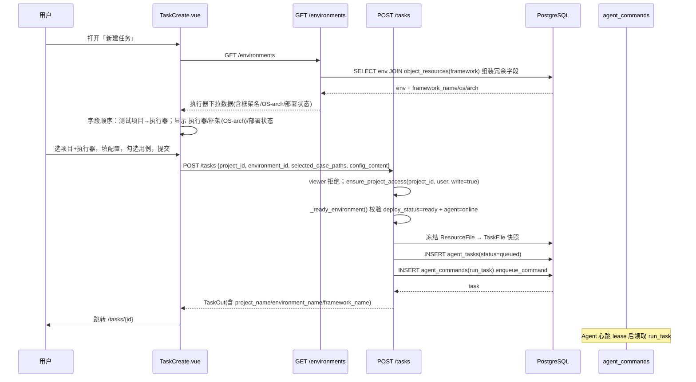
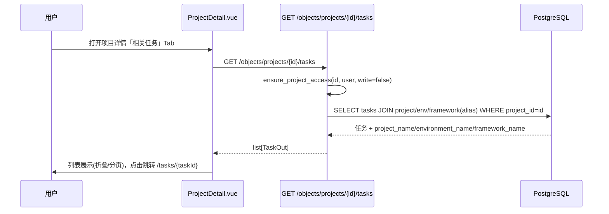

# 测试平台 UI/主线治理与权限细化 — 系统架构设计 + 任务分解

> 架构师：高见远（software-architect）
> 阶段：仅设计，不写代码
> 范围：P0 + P1 + P2 全量（菜单拆平方案 A、术语统一、执行器治理、权限细化）

---

## 一、实现方案 + 框架选型

### 1.0 总体思路

本项目是**存量改造**而非从零搭建：技术栈、数据模型、部署方式全部不可变。因此本次设计遵循三条原则：

1. **后端表名/字段名/变量名不变**，只在 UI 层统一术语（测试项目/测试框架/执行器/任务/Agent）。
2. **复用现有自研迁移机制**（`migrations.py` 幂等迁移 + `init_db.py` 挂载），不引入 Alembic。
3. **名称化（冗余字段）统一由后端组装返回**，前端只消费，不各自 join，避免逻辑散落。

**无需新增任何 npm/pip 依赖**（详见第六节）：Element Plus 已提供 `el-steps/el-tabs/el-tag/el-empty/el-timeline` 等全部所需组件；后端 SQLAlchemy 2.0 的 `select().join()` + `func.count` 足够。

---

### 1.1 P0-1 菜单扁平化 + 术语统一（纯前端）

- `Layout.vue` 的 `navs` 由「对象管理/环境管理」两级分组改为六个一级菜单：
  `仪表盘 / 测试项目 / 执行器 / 测试框架 / 任务 / 用户管理(仅admin)`。
- `router.js` 各路由 `meta.title` 同步统一：`执行器环境管理 → 执行器`、`项目对象详情 → 项目详情`。
- `activeNav` 计算逻辑保留（`/objects/projects/:id` 归 `/objects/projects`，`/tasks/:id` 归 `/tasks`）。
- 后端零改动。

### 1.2 P0-2 任务创建顺序重排 + 框架透明（重点取舍）

**需求**：`TaskCreate.vue` 字段顺序改为「测试项目 → 执行器」；执行器下拉显示 `执行器名 / 框架名(OS-arch) / 部署状态`；选中执行器旁提示已部署框架版本状态。

**取舍结论：采用「后端冗余返回」（server-side join），不用前端 join。**

| 维度 | 后端冗余返回（选定） | 前端 join（放弃） |
|---|---|---|
| 前端改动 | 只消费字段，零 join 逻辑 | 每个页面重复请求 `/objects/frameworks` 并本地 join |
| 复用性 | TaskCreate / Environments / ExecutorDetail / Frameworks 反向索引共用 | 每处独立实现，易错 |
| 后端改动 | `EnvironmentOut` 加 3 字段，list/read 端点 join 一次 | 后端无改动 |
| 一致性 | 与 P0-4 的 `TaskOut.*_name` 方案统一 | 两套风格并存 |

**落地**：`EnvironmentOut` 增加 `framework_name / framework_os / framework_arch`（均可空）；`list_environments` / `read_environment` 由 `select(Environment)` 改为 `select(Environment).join(Resource, Resource.id == Environment.framework_id)`，组装为带冗余字段的 dict 返回。`deploy_status` 已有，前端直接渲染部署状态徽标；已部署框架版本用 `deployed_framework_sha256`（取前 8 位）提示。

> 实现注意：现有端点靠 `ORMModel(from_attributes=True)` 直出 ORM 对象；加入冗余字段后**必须改为手动构造 dict**（或新增非 ORM 的 `EnvironmentOut` 构造函数）。已在 T02 标注。

### 1.3 P0-3 项目详情「相关任务」Tab + 回链

**结论**：新增 **`GET /objects/projects/{project_id}/tasks`**（比在 `/tasks` 上加 `project_id` 过滤更 RESTful，且天然挂 `ensure_project_access` 权限校验）。

- 返回 `list[TaskOut]`（含 `project_name/environment_name/framework_name` 冗余）。
- 权限：`ensure_project_access(db, project_id, user)`（读）。
- 前端 `ProjectDetail.vue` 用 `el-tabs` 增加「相关任务」Tab，复用 Tasks 的折叠/跳转样式，回链 `/tasks/{id}`。

### 1.4 P0-4 任务列表/详情「名称化 + 回链」

**结论**：`TaskOut` 增加 `project_name / environment_name / framework_name`（可空）。`list_tasks` / `get_task` 用 alias join 组装：

- `project` 与 `framework` 都在 `object_resources` 表，需**两次 alias**（`Resource` 作为 project、`Resource` 作为 framework）。
- 非 admin 的 `list_tasks` 已按 `ResourceMember` 过滤，join 名称字段不影响该过滤语义。
- 前端 `Tasks.vue` 项目/执行器列改为可点击（`router.push`），`TaskDetail.vue` overview 显示名称并点击跳转。

### 1.5 P1-1 框架「被哪些执行器使用」反向索引

**结论**：双向结合，但**列表接口只加轻量 count，详情单独接口列执行器**：

1. 新增 `FrameworkOut(ResourceOut)`，含 `used_by_count: int`；`list_frameworks` 改返回 `list[FrameworkOut]`，count 用 `select(func.count(Environment.id)).where(Environment.framework_id == fw.id)`（一次循环或 `subquery`，规模小，循环可接受）。
2. 新增 **`GET /objects/frameworks/{framework_id}/environments`**，返回 `list[EnvironmentOut]`（含框架冗余字段），供卡片展开列出执行器名。
3. 删除前置二次提示：前端 `Frameworks.vue` 在 `used_by_count > 0` 时先弹「该框架正被 N 个执行器使用」二次确认；后端 `delete_framework` 已有「正在被执行环境使用 → 409」兜底。

### 1.6 P1-2 执行器归属 / 分组 / 标签（数据模型 + 迁移）

`Environment` 模型新增三字段（详见 3.1）：

- `owner_id`：归属人（FK users.id，可空）
- `group_name`：分组（VARCHAR(50)，可空，自由文本）
- `tags`：标签（JSON，默认 `[]`，`list[str]`）

迁移函数 `migrate_environment_governance`，幂等 `ADD COLUMN IF NOT EXISTS`；`owner_id` 外键 `DROP CONSTRAINT IF EXISTS` 后再 `ADD`。

前端 `Environments.vue` 增加分组筛选（`group_name` 去重下拉）与标签/归属人列；`TaskCreate.vue` 执行器下拉按分组分组显示（`el-option-group`）。

### 1.7 P1-3 权限细化（校验点盘点）

现状盘点（已实现，仅需前端补 UI 收敛 + 新增接口挂校验）：

| 操作 | 现状 | 结论 |
|---|---|---|
| 框架上传/删除/部署 | 已是 `Depends(admin)` | ✅ 保持，前端隐藏按钮 |
| 框架列表/详情/下载 | `current_user`（全站登录可见） | ✅ 读保持（见待明确事项 1） |
| 项目文件/成员/任务访问 | `ensure_project_access` 已覆盖 | ✅ 新接口全部挂该校验 |

**新增校验点**：
1. `GET /objects/projects/{id}/tasks` → `ensure_project_access`（读）。
2. `GET /environments/{id}/overview`（P2-1）→ 读用 `current_user`，但其中 `task_history` 按项目权限过滤（非 admin 只看自己项目任务）。
3. 前端权限 helper 统一：`const isAdmin = () => auth.user?.role === 'admin'`（放入 `constants.js`），框架管理按钮用 `isAdmin()` 控制。

### 1.8 P1-4 仪表盘强化主线入口

`Dashboard.vue` 增加：
- 「按项目快速开始」卡片：列出项目 + 「运行」按钮（跳 `/tasks/create?project=id`，`canWrite` 才显示）。
- 主线步骤条：`测试项目 → 执行器(携带框架) → 任务 → 结果`，用 `el-steps`，每步可点击跳转。
- 空态引导：无项目时引导「新建测试项目」（admin）或「等待管理员创建」。

### 1.9 P2-1 执行器独立详情页

- 拆出 `ExecutorDetail.vue`（路由 `/environments/executors/:id`，`meta.title: '执行器详情'`），`Environments.vue` 行点击/「详情」按钮进入。
- 后端新增聚合接口 **`GET /environments/{environment_id}/overview`**，一次返回：环境基础 + 框架版本（`framework_id/name/os/arch/latest_sha256`）+ 部署历史（`list[DeploymentOut]` 最近 N 条）+ 任务历史（`list[TaskOut]` 最近 N 条，按项目权限过滤）+ 并发占用（`max_concurrency` 与 `active` = 活跃任务数）。

### 1.10 P2-2 向导式 onboarding + 空态引导

各列表页 `el-empty` 的 `description` 改为「下一步操作」文案 + 按钮（如 `Frameworks.vue` 空态 → admin 显示「上传测试框架」按钮，`Projects.vue` 空态 → admin「新建项目」，`Environments.vue` 空态 → admin「新建执行器」）。文案统一走 `constants.js` 术语映射。

### 1.11 P2-3 路由语义化（**建议：延后**）

**结论：本版本不做路由重命名。** 理由：

1. **成本高**：需改 `router.js` 全部 path、`Layout.vue` navs、以及各视图 `router.push('/objects/projects')`、`/environments/executors` 等硬编码跳转，遗漏即 404。
2. **收益低**：路由是 URL，用户不感知；术语统一已通过 P0-1 的 `meta.title` + 菜单文案达成。
3. **风险**：历史书签/外链需全局 redirect 兼容，维护成本持续存在。

**折中（如需）**：仅在 `router.js` 加两条 `redirect` 别名（`/projects → /objects/projects`、`/executors → /environments/executors`），不改内部 push。**建议延后到独立迭代。**

### 1.12 P2-4 项目维度任务折叠 + 批量筛选增强

- `GET /tasks` 增加可选 query 参数 `project_id / environment_id / status`（后端过滤，`list_tasks` 现有权限过滤不变）。
- `Tasks.vue` 增加「按项目分组折叠」开关（纯前端 `computed` 分组），筛选下拉改服务端参数或保留客户端（低成本：保留客户端筛选，仅补 `status` 精确态）。

---

## 二、文件清单

### 后端（修改 M / 新增 A）

| 文件 | 动作 | 内容 |
|---|---|---|
| `backend/app/models/environment.py` | M | Environment 加 `owner_id/group_name/tags` |
| `backend/app/db/migrations.py` | M | 新增 `migrate_environment_governance` |
| `backend/app/db/init_db.py` | M | 挂载新迁移 |
| `backend/app/schemas/environment.py` | M | `EnvironmentIn/Out` 扩展；新增 `EnvironmentOverviewOut` |
| `backend/app/schemas/resource.py` | M | 新增 `FrameworkOut(ResourceOut)`（`used_by_count`） |
| `backend/app/schemas/task.py` | M | `TaskOut` 加 `project_name/environment_name/framework_name` |
| `backend/app/schemas/__init__.py` | M | 导出新 schema |
| `backend/app/api/v1/endpoints/environments.py` | M | list/read 冗余框架字段；create/update 处理治理字段；新增 `/overview` |
| `backend/app/api/v1/endpoints/frameworks.py` | M | 列表返回 `used_by_count`；新增 `/{id}/environments` |
| `backend/app/api/v1/endpoints/tasks.py` | M | 名称化冗余 + query 过滤 |
| `backend/app/api/v1/endpoints/projects.py` | M | 新增 `GET /{id}/tasks` |
| `backend/app/crud/environment.py` | M | 新增 `list_with_framework`、`count_active_tasks`（已有）复用；overview 聚合 |
| `backend/app/crud/resource.py` | M | 新增 `count_environments_by_framework`、`list_environments_by_framework` |

### 前端（修改 M / 新增 A）

| 文件 | 动作 | 内容 |
|---|---|---|
| `frontend/src/constants.js` | A | 术语映射常量 + 权限 helper（`TERM`、`isAdmin`） |
| `frontend/src/router.js` | M | meta.title 术语统一；新增 `ExecutorDetail` 路由 |
| `frontend/src/views/Layout.vue` | M | navs 拆平为一级菜单 |
| `frontend/src/views/TaskCreate.vue` | M | 字段重排 + 框架透明化（P0-2） |
| `frontend/src/views/Tasks.vue` | M | 名称列可点击 + 项目折叠 + 筛选（P0-4/P2-4） |
| `frontend/src/views/TaskDetail.vue` | M | overview 名称化回链（P0-4） |
| `frontend/src/views/ProjectDetail.vue` | M | 「相关任务」Tab（P0-3） |
| `frontend/src/views/Environments.vue` | M | 分组/标签/归属 + 详情入口（P1-2/P2-1） |
| `frontend/src/views/ExecutorDetail.vue` | A | 执行器详情页（P2-1） |
| `frontend/src/views/Frameworks.vue` | M | 反向索引 + 删除二次确认 + admin 权限（P1-1/P1-3） |
| `frontend/src/views/Dashboard.vue` | M | 快速开始 + 主线步骤条 + 空态（P1-4） |
| `frontend/src/views/Projects.vue` | M | 空态引导（P2-2） |

### 文档

| 文件 | 动作 |
|---|---|
| `docs/system_design.md` | A（本文件） |
| `docs/class-diagram.mermaid` | A |
| `docs/sequence-diagram.mermaid` | A |
| `docs/api.md` | M（追加新端点，可选） |

---

## 三、数据结构与接口

### 3.1 表字段变更（含迁移函数名）

表 `agent_environments`（模型 `Environment`）新增：

| 字段 | 类型 | 说明 |
|---|---|---|
| `owner_id` | INTEGER NULL | 归属人，FK `users.id`，`ON DELETE SET NULL` |
| `group_name` | VARCHAR(50) NULL | 分组，自由文本 |
| `tags` | JSON NOT NULL DEFAULT '[]' | 标签 `list[str]` |

迁移函数（`backend/app/db/migrations.py` 新增，`init_db.py` 挂载于 `migrate_framework_os_arch` 之后）：

```python
def migrate_environment_governance(engine: Engine) -> None:
    if engine.dialect.name != "postgresql":
        return
    with engine.begin() as connection:
        connection.execute(text('ALTER TABLE "agent_environments" ADD COLUMN IF NOT EXISTS "owner_id" INTEGER'))
        connection.execute(text('ALTER TABLE "agent_environments" ADD COLUMN IF NOT EXISTS "group_name" VARCHAR(50)'))
        connection.execute(text('ALTER TABLE "agent_environments" ADD COLUMN IF NOT EXISTS "tags" JSON NOT NULL DEFAULT \'[]\''))
        connection.execute(text('ALTER TABLE "agent_environments" DROP CONSTRAINT IF EXISTS "fk_agent_environments_owner_id"'))
        connection.execute(text('ALTER TABLE "agent_environments" ADD CONSTRAINT "fk_agent_environments_owner_id" FOREIGN KEY ("owner_id") REFERENCES "users" ("id") ON DELETE SET NULL'))
```

### 3.2 新增 / 变更 API 端点

| 方法 | 路径 | 权限 | 说明 | 对应 P |
|---|---|---|---|---|
| GET | `/environments` | current_user | **变更**：返回冗余 `framework_name/os/arch` + `owner_id/owner_name/group_name/tags` | P0-2/P1-2 |
| POST/PUT | `/environments` / `/{id}` | admin | **变更**：接受 `owner_id/group_name/tags` | P1-2 |
| GET | `/environments/{id}/overview` | current_user | **新增**：聚合详情（框架版本/部署历史/任务历史/并发） | P2-1 |
| GET | `/objects/frameworks` | current_user | **变更**：返回 `FrameworkOut`（含 `used_by_count`） | P1-1 |
| GET | `/objects/frameworks/{id}/environments` | current_user | **新增**：被哪些执行器使用 | P1-1 |
| GET | `/objects/projects/{id}/tasks` | ensure_project_access(读) | **新增**：项目相关任务 | P0-3 |
| GET | `/tasks` | current_user(+项目过滤) | **变更**：返回名称冗余 + 可选 `project_id/environment_id/status` 过滤 | P0-4/P2-4 |

### 3.3 关键 Schema 字段

```python
# schemas/environment.py
class EnvironmentIn(BaseModel):
    name: str; host: str; work_root: str = "/opt/kw-executor"
    max_concurrency: int = 1; framework_id: int; enabled: bool = True
    owner_id: int | None = None          # 新增
    group_name: str | None = None        # 新增
    tags: list[str] = []                 # 新增

class EnvironmentOut(ORMModel):          # 扩展（非 ORM 直出，端点手动组装）
    # ...原有字段...
    owner_id: int | None
    owner_name: str | None
    group_name: str | None
    tags: list[str]
    framework_name: str | None           # 冗余
    framework_os: str | None             # 冗余
    framework_arch: str | None           # 冗余

class EnvironmentOverviewOut(BaseModel):  # 新增（P2-1）
    environment: EnvironmentOut
    framework: dict | None               # {id,name,os,arch,latest_sha256}
    deploy_history: list[DeploymentOut]
    task_history: list[TaskOut]
    concurrency: dict                    # {max:int, active:int}

# schemas/resource.py
class FrameworkOut(ResourceOut):         # 新增（P1-1）
    used_by_count: int = 0

# schemas/task.py
class TaskOut(ORMModel):                 # 扩展（端点手动组装）
    # ...原有字段...
    project_name: str | None             # 冗余
    environment_name: str | None         # 冗余
    framework_name: str | None           # 冗余
```

---

## 四、程序调用流程

### 4.1 创建任务完整链路（含权限校验 + 框架透明化字段来源）



### 4.2 项目详情查任务历史链路



---

## 五、任务列表（有序，含依赖）

> 说明：本项目为存量改造，无新增脚手架配置文件，故 T01 以「后端数据层地基」（模型/迁移/schema）作为基础设施先行，等价于从零项目的「配置+入口+依赖声明」地基职责。

| ID | 任务名 | 源文件 | 依赖 | 优先级 | 覆盖 P |
|---|---|---|---|---|---|
| **T01** | 后端数据层地基：模型字段 + 迁移 + Schema 扩展 | `models/environment.py`、`db/migrations.py`、`db/init_db.py`、`schemas/environment.py`、`schemas/resource.py`、`schemas/task.py`、`schemas/__init__.py` | — | P0 | P1-2、P0-2/0-4、P1-1（schema 部分） |
| **T02** | 后端 API 层：名称化冗余 + 治理字段 + 新增端点 + 权限校验 | `api/v1/endpoints/environments.py`、`api/v1/endpoints/frameworks.py`、`api/v1/endpoints/tasks.py`、`api/v1/endpoints/projects.py`、`crud/environment.py`、`crud/resource.py` | T01 | P0 | P0-2/0-3/0-4、P1-1/1-2/1-3、P2-1/2-4 |
| **T03** | 前端基础改造：菜单拆平 + 术语统一 + 常量/权限 helper | `views/Layout.vue`、`router.js`、`constants.js`(A) | T01 | P0 | P0-1、P1-3(前端 helper) |
| **T04** | 前端任务主线：TaskCreate 重排 + Tasks/TaskDetail/ProjectDetail 名称化与回链 | `views/TaskCreate.vue`、`views/Tasks.vue`、`views/TaskDetail.vue`、`views/ProjectDetail.vue` | T02、T03 | P0 | P0-2/0-3/0-4、P2-4 |
| **T05** | 前端治理与向导：执行器治理/详情 + 框架反向索引 + 仪表盘 + 空态 | `views/Environments.vue`、`views/ExecutorDetail.vue`(A)、`views/Frameworks.vue`、`views/Dashboard.vue`、`views/Projects.vue` | T02、T03 | P0 | P1-1/1-2/1-4、P2-1/2-2 |

**依赖图**：T03 与 T02 可并行（均仅依赖 T01）；T04/T05 依赖 T02+T03，线性链仅 3 层。

---

## 六、依赖包列表

**结论：无新增依赖。**

- 前端：`vue / vue-router / element-plus / axios` 已覆盖（`el-steps`、`el-tabs`、`el-tag`、`el-timeline`、`el-empty`、`el-option-group` 均内建）。
- 后端：`fastapi / sqlalchemy / pydantic` 已覆盖（`select().join()`、`func.count`、`JSON` 列类型、`list[T]` 泛型均现成）。

---

## 七、共享知识

```
1. 术语映射（仅 UI 层，后端不变）：测试项目 Project / 测试框架 Framework / 执行器 Executor / 任务 Task / Agent。
   前端统一从 frontend/src/constants.js 读取 TERM 常量，禁止散落硬编码中文。
2. 权限 helper：
   - 后端：ensure_project_access(db, project_id, user, write=False)；框架写操作 Depends(require_roles("admin"))。
   - 前端：constants.js 导出 isAdmin = () => auth.user?.role === 'admin'；项目写权限沿用 member.role === 'developer'。
3. 名称化冗余字段命名约定：*_name / *_os / *_arch，一律由后端组装，前端只读。
4. API 封装：统一 api.get/post/put/delete，错误由 api.js 拦截器统一 ElMessage，页面不重复 try/catch 提示。
5. 迁移约定：幂等，ADD COLUMN IF NOT EXISTS；外键先 DROP CONSTRAINT IF EXISTS 再 ADD；迁移统一挂载 init_db.py。
6. 返回 schema：ORM 直出用 ORMModel(from_attributes=True)；带冗余字段必须端点手动构造 dict，避免 from_attributes 拿不到 join 字段。
7. 部署约定（不可变）：前端 npm build + deploy_frontend.py；后端 SFTP 同步源码 → docker build --no-cache → force-recreate backend。
```

---

## 八、待明确事项

1. **框架下载权限**：PRD 拍板「读操作全站登录可见」。但 `GET /objects/frameworks/{id}/download` 返回的是可执行归档包，普通用户创建任务只需看框架名/版本，未必需要下载。建议下载也可收紧为 admin（或 admin+developer），请确认是否与「读全站可见」一起放宽。
2. **执行器分组字段设计**：`group_name` 建议自由文本（前端下拉按现有值去重），`tags` 自由标签，`owner_id` 选填。若需预定义分组/固定标签集，需另行提供配置入口，请确认采用自由文本。
3. **路由重命名（P2-3）**：本设计建议**延后**（成本高收益低）；如团队坚持，仅加 `redirect` 别名不改内部 push。请确认延后。
4. **任务历史分页**：项目相关任务/执行器任务历史当前返回全部（前端折叠/前端分页）；若任务量大，建议后续加服务端分页参数，请确认本版本是否要求分页。
5. **执行器归属人展示**：`owner_name` 是否需要在执行器列表与详情中作为可筛选维度（按人过滤）？当前设计仅展示 + 分组过滤，请确认。

---

## 执行摘要（≤200 字）

本次设计对存量平台做「主线治理 + 权限细化」：菜单拆平、术语统一（纯前端）；任务创建顺序重排并采用**后端冗余返回**框架名/OS-arch（不用前端 join）；新增项目相关任务、框架反向索引、执行器详情聚合三类端点；执行器增加归属人/分组/标签（自研幂等迁移）；框架写操作收口 admin、用例走项目成员权限。拆为 5 个任务：后端数据地基 → 后端 API → 前端基础 → 前端任务主线 → 前端治理向导，无新增依赖。建议：路由重命名延后；框架下载权限是否收紧待确认。
